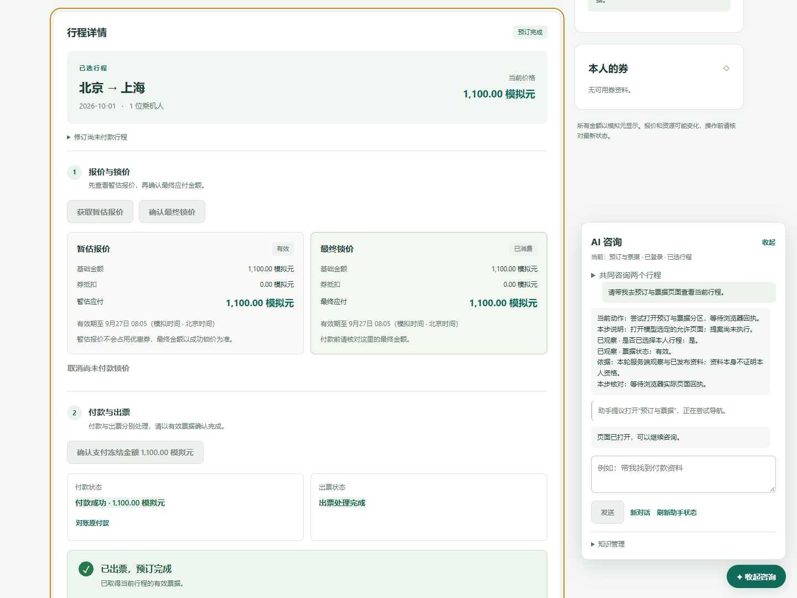

# V1最终验收与交付

> 公开脱敏说明：本机/服务器位置已改为仓库相对路径或私有配置占位项（`PRIVATE_*_DIR`）；本机私有记录未随仓库发布。原始材料在本机保留，历史命令不构成当前运行或费用许可。

2026-11-06（Asia/Shanghai）。**V1-01/M1、V1-02/M2和V1-03/M3按既定有限场景完成。** 本次交付的是可在本机复现的模拟差旅指引作品；原研究中的双行程最优规划、全面版本适配、公平对照、本地8B与微调仍未验收，按QDIR-01后置，不自动启动。

## 交付范围与逐项证据

| 门槛 | 结果 | 权威证据与边界 |
| --- | --- | --- |
| M1 动作、证据、可信呈现 | 通过 | [41报告](41V1动作证据契约与本地交付.md)；single-action-evidence-1、真实工具一致性、事实/身份/期限反例继续生效，不补模型动作或工具 |
| A 本人单行程持续出票 | 通过 | Q35/run-04同一真实模型任务四轮lock→pay→query→end；原网页忠实执行，最后独立有效票、唯一付款/扣款110000模拟分、库存2/0/1。独立SQL（本机私有记录，未发布：`../.local/v1-42/run-04/independent-sql.json`）、真实终态（本机私有记录，未发布：`../.local/v1-42/run-04/turns/1-terminal.json`） |
| B 当前页面与导航 | 通过，保留先前失败 | Q35曾错页/缺工具而被503拒绝；修正后Q36/run-05从welcome真实提出navigate booking，同响应有实际工具；原浏览器DOM焦点、语义观察与nonce ACK成功，同一会话完成。真实ACK（本机私有记录，未发布：`../.local/v1-42/run-05/turns/1-01-ack.json`）、执行（本机私有记录，未发布：`../.local/v1-42/run-05/turns/1-01-execution.json`） |
| C 已付待票与状态变化 | 通过，与A共用任务 | Q35第3轮真实输入观察到付款succeeded、出票pending、无有效票；选择查询原付款而非重复付款，第4轮重新观察到有效票再end。中间点（本机私有记录，未发布：`../.local/v1-42/run-04/paid-before-ticket.json`）、第3轮（本机私有记录，未发布：`../.local/v1-42/run-04/turns/1-03-formal.json`）、第4轮（本机私有记录，未发布：`../.local/v1-42/run-04/turns/1-04-formal.json`） |
| D 未覆盖问题 | 通过 | Q36新会话询问未说明的国际签证，真实候选unknown/gap=unsupported，无工具，无编造操作。正式答复（本机私有记录，未发布：`../.local/v1-42/run-05/turns/2-01-formal.json`）、终态（本机私有记录，未发布：`../.local/v1-42/run-05/turns/2-terminal.json`） |
| E 身份/对象/迟到结果/关键事实 | 通过，复用程序反例 | 41/42原有效反例与本轮runtime夹具18项；新增只读与完成授权17项。切换主体/会话/私有状态或停止后不交付/不推进，错金额、伪管理员和重复确认仍拒绝；不额外调用模型 |
| F 审阅、发布、新会话、回滚 | 通过，复用原知识UI | lab-1106-events及lab-q36-bd在原管理UI核实审阅/发布/新会话/回滚。知识UI（本机私有记录，未发布：`../.local/v1-42/lab-q36-bd/knowledge-ui.json`）。来源为原Q31→d3-26真实构建，保留旧观察日期，不声称本次训练或跨产品版本适配 |
| M3 可复现作品 | 完成 | [README](../README.md)、[演示与复现](V1演示与复现.md)、[运行说明](运行说明.md)、[可追踪脱敏摘要](assets/v1-42/2026-11-06验收摘要.json)及真实连续截图；lab与live均在原环境实际启动。所有服务正常退出，数据保留；没有自动提交/推送/发布 |

A/C来自Q35的assistant-13；B/D来自Q36的assistant-14，知识哈希相同，14仅追加公开页面映射与工具协议生成示例。不能声称四项来自单一提示词版本的一次稳定运行；这是一次保留失败与修正来源的有限功能验收，不是统计成功率或原研究公平矩阵。

## 本次恢复授权与实际执行

用户先选择暂不新增付费，之后明确指令“允许新增付费调用，做完它”，后者替代费用限制。按已说明剩余范围仅恢复2次/总预留0.064元，没有推断无限预算或重开旧批。

原Q36历史包及approved=false决定保留。重新冻结当前源为manifest `41c85da152e61d6831d422c2192a0c6347616e186e5720bcc93c32a941ea2b44`（110文件），新执行包（本机私有记录，未发布：`../.local/v1-42/review-q36-resumed/package.json`）、直接用户指令记录（本机私有记录，未发布：`../.local/v1-42/review-q36-resumed/decision.json`）、执行源码快照（本机私有记录，未发布：`../.local/v1-42/frozen-q36-resumed-map.json`）分别保留。直接指令没有异步问题ID，来源引用明确标为本聊天直接消息。

run-05真实2次均通过，2会话、1次真实导航ACK；没有脚本候选，工程逐条读取完整答复后一次忠实确认。最终浏览器结果（本机私有记录，未发布：`../.local/v1-42/run-05/browser-result.json`）为passed。只读续验服务端拒绝任何业务写入；前后独立SQL（本机私有记录，未发布：`../.local/v1-42/run-05/independent-sql.json`）按原JSON投影逐值完全相同，没有reset、新付款、出票或worker事件。

| 项目 | 记账结果 |
| --- | --- |
| 本次恢复新增调用/金额 | 2次 / 0.00899592 CNY |
| Q35与本次恢复合计新增 | 7次 / 0.03080960 CNY，含Q35的B失败 |
| 原连续账本累计 | 57次 / 0.21431272 CNY / 未决0 |
| Q36停止状态 | completed，许可已永久关闭，无未用余量 |

以上金额是原预算账本会计记录，供应商账单与账户余额未独立对账。峰值会计价格沿本日[官方价格页](https://api-docs.deepseek.com/zh-cn/quick_start/pricing/)再次核对不变；模型、限额与隐私/账户未知边界不变。未新增Search/Fetch、模型服务、训练或生产部署。

## 实现修复与验证

1. 合法wait原先不能推进只在第2次query出票的模拟机制。现用每轮忠实完成后的明确虚拟事件，先结算付款、保留已付0票观察点、下一事件出票；不依赖模型补query，不是墙钟自主后台。
2. confirm重新采集当前授权；无原业务写入回执的wait/end/navigation在complete前也核验当前主体/会话/私有状态，错误end先SQL且不tick，防止确认后换主体继续推进。
3. assistant-14公开页面映射与通用profile协议示例改善导航生成；原无工具或页不一致候选仍拒绝，不修改候选、强制工具或伪造ACK。
4. B/D只读批在业务middleware先拒绝所有业务写入并持久停批，即使已有confirmed query也不能进入业务层。新增2项反例连同原授权检查共17项通过。
5. pytest同名模块收集冲突通过importlib/helper路径解决；原生隔离前置需55432在线，按原恢复说明启动并真实probe通过，未reset原库、改ACL或扩大系统信任。

整体检查已先执行，实际失败修复后只补失败模块与未运行部分：首批195通过、5个环境前置失败；恢复后剩余2248通过。后续源变化仅定向验证：导航生成5项、Q36预算2项、生成/完成集成20项、当前runtime夹具18项，最新只读/完成授权17项。按不重复用例取最后结果为2440项通过；这不表示当前所有源码再次完整回归或模型任务成功率。前端`npm.cmd run build`通过。

主要命令与结果报告：

~~~powershell
# 整体及恢复后剩余检查，原输出保留，不重复执行
.\.venv\Scripts\python.exe -X utf8 scripts/round20_sandbox.py test -- -q --basetemp=.local/v1-42/overall-1106-fixed-pytest --junitxml=.local/v1-42/overall-1106-fixed.xml --maxfail=5
# 仅失败模块及尚未运行的部分
.\.venv\Scripts\python.exe -X utf8 scripts/round20_sandbox.py test -- -q tests/business/test_guide_runtime.py tests/business/test_observation.py tests/business/test_personal.py tests/business/test_reads.py tests/business/test_safety.py tests/business/test_v1_worker_events.py tests/guide --basetemp=.local/v1-42/overall-1106-remaining-pytest --junitxml=.local/v1-42/overall-1106-remaining.xml --maxfail=5
# 最新只读门定向检查
.\.venv\Scripts\python.exe -X utf8 -m pytest -q tests/guide/test_v1_complete_authorization.py --junitxml=.local/v1-42/readonly-authorization-fixed.xml
~~~

原失败日志全部保留，包括首次同名导入、未启动55432的隔离前置、只读反例测试夹具重复关键字及收尾比较脚本缺datetime序列化。后两者分别修正夹具和沿原save的JSON投影，未重复模型调用或修改业务结果。Starlette/httpx弃用警告未隐藏、未因此升级依赖。

## 截图与环境

[真实未知处理](assets/v1-42/Q36真实模型-保留未知.png)、[真实已付待票](assets/v1-42/Q35真实模型-已付待出票.png)、[真实有效票核对](assets/v1-42/Q35真实模型-有效票核对.png)均已实际查看，来源为模型正式答复和原浏览器，无凭证或真实账户数据。

项目仍在.，解释器/前端/PostgreSQL沿原.venv与.local，未安装、搬迁或修改全局PATH/ACL/信任。原55432未reset。run-05的API/PG及后续只读SQL核账实例正常退出，Vite按核验的本项目PID关闭，8000/5173/55432/55433无监听。数据、旧失败、批准与冻结原件保留，不清理或覆盖。

## 完成边界与后续

当前P42、M1–M3及V1作品的必要实现、有限验收和交付材料完成，V1无必要剩余项；原研究未完成且按用户决定后置。未提交、推送、外部发布，不把这些未经请求的动作列作当前完工阻塞。后续研究入口按仓库交接规则另备43，必须等待用户明确恢复研究与所需具体范围/费用决定，本次不执行。
