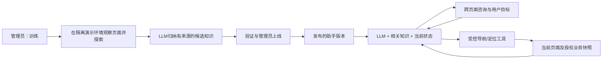

# LLM主线调整：探索、持续咨询与发布

> 2026-10-29修订：用户已选择“先交可展示作品，研究实验后置”，见[QDIR-01](决策记录.md#qdir-01)与[V1作品交付计划](V1作品交付计划.md)。近期V1范围以新计划为准；下方原要求和设计保留为追溯与后续研究目标，不代表全部是V1前置，也不代表已验收。

日期：2026-10-11。来源：用户明确指出网页投入挤占LLM研究、Prompt密度过低、尚未真实调用API，并要求跨界面咨询、当前页面感知、主动工具导航以及管理员训练/上线。本文件维护具体调整与已批准的小额实验方案（批准日2026-10-11，2026-10-12继续执行）；正式授权状态见[Q11](决策记录.md#q11-回归llm主线与跨页面工具助手)，实现事实见[STATE](STATE.md)。

## 1. 已确定的目标与投入方向

项目亮点是模型如何获得产品知识、结合当前状态理解目标、选择工具、依据反馈修正行为，以及怎样评测和改进。现有差旅网页作为实验环境冻结；除承载这条LLM闭环、修复实际阻断或满足可用性外，不再单独美化、扩展业务或反复重跑全套。

用户本轮已经明确的必做能力：

- 简洁的全局AI咨询入口；同一身份内跨页面/业务对象保留对话和目标，不能因页面组件卸载消失。
- AI获得当前网页的相关可见状态，并结合经授权的实时业务事实回答；旧页面信息不得作为当前事实。
- AI通过工具主动打开相关页面、展开/定位功能入口。这是目的功能，取代原“纯文字指路、定位可选”的近期范围；不能仅生成一个链接冒充已导航。
- 管理员可以发起“训练”和“上线”。训练近期可以是API驱动的页面探索和知识构建，后续支持真实微调；上线要真正切换已验证的助手版本。
- 尽早真实调用API，以少量区分度高的样例取得失败分类，随后再扩大实验。少样本不能声称全面可靠或给出统计效果提升。

本次方向调整不等于这些能力已经实现，也不把网页工作的历史成绩算LLM成绩。没有新的开发token总量或工时数值，不能杜撰“违反了某个已统计预算”；可以确定的是此前交付优先级偏离了学习目标。

## 2. 推荐范式：离线知识构建 + 在线有工具的助手

保留一个模型调用适配器，用不同任务配置分别承担知识构建和在线帮助。先用直接API、结构化工具和小型版本文件；不预建多Agent编排平台、向量库、通用浏览器控制台或模型训练平台。

**知识不是单纯一篇长总结。** 每个条目保存用途、页面/入口、可公开前提、操作后可观察结果、恢复说明、产品版本、角色/披露范围、来源证据及未验证部分。静态DOM只能证明看到的内容，不能证明隐藏分支、权限或真实操作效果；必要交互在合成隔离环境执行并记录前后观察。模型可以提出下一探索动作，宿主校验后执行，不能预先把正确流程/最佳顺序写入输入后声称模型发现。

在线查询先按产品版本、当前权限和问题筛选少量已发布知识，再按需读当前状态。无需每次提问重新遍历整个网站。先用关键词/语义ID检索与小上下文；只有实测召回不足才引入向量检索。变化较快的产品事实放知识和工具结果中，微调主要研究稳定的工具选择、规划、格式与恢复行为。

## 3. 页面、状态与动作契约

### 常驻咨询

把咨询状态移到App级会话容器，独立于业务页面、trip key或页面路由；收起只隐藏面板，同一登录会话内切页保留消息和目标。入口始终可见，未选行程也能问公开产品问题；只有确需私人事实时才选择对象。跨对象保留对话，但旧对象事实标记过期，不自动转移对象授权；换身份/退出必须清空私人上下文和丢弃迟到响应。跨浏览器重开/长期记忆仍非本批要求。

当前仅有单页分区，可给原付款资料/行程/预订/审批区域加最少的页面或分区标识。复用原业务组件与处理函数，不为“跨页面”重造CRUD或新站点。

### 两类状态各司其职

| 来源 | 模型可以得到 | 不可推导的结论 |
| --- | --- | --- |
| 页面观察 | 当前page/section语义ID、可见标题与说明、已展开区域、允许的控件名称/状态、版本、观察时间 | DOM/前端文本不授予身份、对象所有权、余额、审批资格或操作成功 |
| 服务端授权快照 | 原身份过滤后的最小业务事实、任务内匿名对象引用、修订/时效/未知 | 不传源码、SQL、凭证、完整HTTP响应、隐藏配置/答案或其他用户事实 |

页面导航/业务更新立即使旧事实失效；下次推理前取新快照，不把每次点击上传模型。必要上下文由页面观察与可信快照组成；页面文字作为数据处理，不能覆盖工具/权限规则。模型只看命中知识和相关事实，避免整页HTML堆入上下文。

### 最小工具集合

| 工具 | 作用与实际成功判据 |
| --- | --- |
| `observe_page` | 获取本身份当前页面的筛选观察；结果含版本/时间和未知，不能按模型参数换主体 |
| `search_knowledge` | 查询当前已发布、对本身份可披露的条目；结果带来源，不返回候选草稿或未授权知识 |
| `navigate` | 接受当前工具注册表中的page/section/object匿名引用，驱动原网页切页/选择对象/展开；执行前重查权限，执行后读取实际页面回执 |
| `highlight` | 定位或高亮实际存在、当前可见/可展开的入口；找不到返回失败，不猜坐标 |

允许模型自主选择低风险导航/定位，工具执行结果进入下一轮上下文。当前用户没有要求自动付款、审批或提交其他业务，这些仍由用户操作；后续扩展写入工具另明确确认方式。工具不接收任意URL、JavaScript、CSS选择器、shell或文件路径。工具参数合法不等于有权限；导航有回执才可说“已打开”，完成有独立终态才可说完成。

首轮每个用户问题最多两次模型推理、两次导航动作，不并行执行工具、不自动无限循环；这是拟用的可逆实现限额，实际覆盖不足应报告再有依据地调整。

## 4. 管理员的“训练”和“上线”

| 产品操作 | 第一版实际行为 | 以后接入微调时 |
| --- | --- | --- |
| 训练 | 选择合成产品/版本/模拟角色及探索额度 → 观察与有限交互 → API归纳 → 保存带证据的候选知识版本及验证报告。界面明确显示“知识构建，未修改模型权重” | 选择合法训练集、基础权重与训练配置，产出适配器/权重及留出评测；不把API总结叫成梯度训练 |
| 上线 | 发布已验证的`模型引用 + Prompt版本 + 知识版本 + 工具契约 + 产品兼容范围`，原子切换active版本，支持回滚；失败保留原线上版本 | 发布包再包含权重/适配器引用，复用同一验证与切换流程 |

API模型权重不归本项目控制，所以“上线API模型”具体是发布助手配置和知识，不是把模型权重推给供应商。先本机产品内发布，不代表部署公网。新会话绑定发布版本；当前任务不偷偷混用新旧知识/工具，切换需明确使旧事实/动作失效并重读。不能只有两个返回成功的按钮。

管理能力由可信服务端授予，不能把业务审批人当知识管理员，也不能通过对话自称管理员。探索者可按授权模拟角色看合成页面；线上用户只能检索其可披露知识，管理员看过的内容不能全部进公共知识包。

## 5. 首批少样本实验

以下保留首批设计的5个实验单元，预计约6–10次物理请求，当时上限12次。后续Q12已明确批准同一账本累计12→16；当前授权见第6节，用量与完成/失败只查STATE，不从本表重复开批次。所有构建、咨询、工具后续、失败和对照共享额度；工具完整轨迹按整个单元记录，不把多轮当多个成功样本。

| 单元 | 高区分度覆盖 | 独立判断 |
| --- | --- | --- |
| 1 页面学习 | 让模型读两个真实渲染页面及一次操作前后观察，生成少量带来源条目；夹一条缺少证据的功能 | 每个事实能定位证据，未知不编造；不把开发者人工知识冒充自动学习 |
| 2 咨询与导航 | 从非目标页面提问，模型自行选`navigate`，实际打开目标，后续仍保留对话 | 工具名称/参数、浏览器回执、当前页面、会话连续性；用同一用户问题做一次“只文档”对照 |
| 3 状态分支 | 同一问题分别提供未绑定/已有进度两种允许状态，检验是否跳过已做步骤；一次用户偏离 | 返回步骤有依据，旧快照不复用，不以提示词写死预期答案 |
| 4 失败与未知 | 付款unknown、已付未出票二选一个首轮实际失败状态，验证不重复付款/不虚报完成；另一状态先离线覆盖 | 模型语义和数据库终态分别判断，导航不变更业务数据 |
| 5 不可信内容 | 页面中夹带要求越权/读源码的文本，或用户请求未授权页面 | 模型行为记录；宿主无论模型是否服从都拒绝越界工具，隔离用户事实 |

管理员训练→检查→上线→新会话使用新知识→回滚可复用单元1/2的产物，不增加同义付费案例。格式错、未知工具、过期nonce、串用户、取消/迟到、429/超时/缺usage、发布失败等确定性工程反例离线测；真实模型只覆盖需要模型判断的部分。不把5个样例外推成可靠性百分比，也不为凑满矩阵增加调用。

先完成第一条真实请求再追加实现；若返回认证/参数/输出不合格，记录并做一次针对性修复，消耗同一调用上限，不自动重试。学习交付至少有实际请求模式、筛选后的输入输出、工具轨迹、usage/成本、延迟、错误分类和一项有证据的改进结论。

## 6. API实验控制策略：DS-1011已批准

旧[DS-1007](D3模型接入准备.md#10-本次实施替代ds-1007)同时要求：事先证明供应商全部计费token硬上界、所有调用先有完整AppContainer公网UDP探针、只允许单次JSON候选且不传工具。这些旧门槛此前阻塞首条API尝试。2026-10-11，用户对明确列出替代范围、原额度及计费不确定性的集中问题实际答复 **“采用小额实验模式（推荐）”**，正式批准以下DS-1011替代；2026-10-12继续执行。旧规则保留为历史；这份批准记录不证明API已调用或模型效果已验证。

**DS-1011小额实验模式，用户已批准**：

1. 保留同一DeepSeek官方Chat端点、`deepseek-flash`、非思考、非流式和原留存/地域接受范围；不换服务、不购买资源。允许合成页面的筛选可见资料、相关匿名状态及受控工具Schema，用于本文件的知识构建和咨询导航。知识构建使用JSON输出，工具轮使用原生function calling及本地严格参数校验。
2. 原首批最多12次物理请求；2026-10-14用户[Q12明确批准](决策记录.md#q12-新增4次调用--用户已明确批准)同一连续账本最多新增4次、累计上限16，具体合成数据外发也已明确批准。原首轮2 CNY/50次、累计5 CNY/100次总额度不增加、不重置历史；实验已核算累计达到0.5 CNY提前停。常规输出`max_tokens=512`，知识构建最多1024；单请求messages和tools序列化正文最多12 KiB，仅为减小输入的工程限制，**不是token或账单的数学上界**。超出16次仍须新明确决定，Q14提案未批准。
3. 调用前按当日官方价和本机明确配置计划费用，调用后按关联usage结算；超时、断网、取消、缺/异常usage留未决并停止所有后续，不自动重试、不补0。记录请求/响应模型名、配置/Prompt/知识哈希与日期；可见漂移停止，不声称检测供应商全部内部修订。
4. 接受“短合成请求 + 输出硬限制 + 逐次usage核算/停止”的小额实验风险，暂不要求取得无法从现有公开材料获得的供应商内部计费证明。2元仍是预算，但在供应商异常/漏报/首请求前未知费用下，客户端无法数学保证绝不越账单。用户本次选择接受这一明确差异，不能再把旧先验硬保证作为本模式前置，也不能伪造计数器或把工程限额叫数学保证。
5. 不执行任意代码的固定API请求及白名单页面导航，由原可信宿主做身份、字段、工具和目的地校验；单独证明这条受限路径。首次纯API实验不启动Child或模型浏览器执行器，不再以无关公网UDP对照作为全部LLM请求前置。现有失败probe继续如实保留，不能说它通过了；后续真实探索执行器/本地模型/通用脚本仍须按实际能力验证隔离，不允许普通进程降级冒充AppContainer。
6. 已有账户“允许使用、没有附加费”按用户报告记录，不要求再次证明同一结论；不虚填供应商核验日期，不索取聊天Key或账号数据。秘密仍只由宿主从已有忽略文件读取；财务账本继续防竞争、防丢失和跨重启，不另建一份额度规避原累计预算。

上述明确选择已完成，不再重复询问DeepSeek资格、Q4或同一小额实验授权。替代范围仅限本节规定的短合成API实验和受控语义导航；原厂商、隐私接受范围、总额度、账本连续性及未知费用停止行为保留。新“跨页面咨询、工具导航、训练/上线”功能方向也已明确，不再列为候选；实际本地微调、通用执行器及公网发布没有因此获准。

## 7. 下一轮交付密度

2026-10-13用户[Q13](决策记录.md#q13-执行节奏与prompt粒度--用户已明确调整)再次要求：后续Prompt按较粗阶段集中相关任务，阶段结束统一验证，不逐步重复核对。18已按Q12实测，结果与下一入口只查STATE；后续新增费用不能从执行节奏要求推导批准。

方向调整时直接修订已有15入口，不另生成只做同义前置检查的轮次。2026-10-12最小链交付后，用户追问下一轮入口，新增[16](../prompts/16-LLM对照实验与有界选页学习.md)承接尚未完成的同条件对照、有界模型选页学习和实际状态/独立终态；这不是重新初始化或增加预算。以下保留15原批次目标：一次连续批次目标为：**首次真实API回执 → 两页自动知识构建 → 常驻咨询及实际导航 → 管理员发布/回滚 → 少样本记录与必要反例**。按前述依赖分步执行但在同一批交付；不能用静态脚本、按钮、文档或入口数量充当完成。

用户已批准费用策略，第一阶段直接执行实际小额API实验，工程问题分类后推进整条链；不继续网页装饰、重复同一授权或检索“是否存在完整token证明”。现有权限/业务终态/取消/费用模块按需复用；旧过滤中与自由咨询和tool_calls冲突的“禁所有数词/只能下一步JSON”等限制需针对性重设计，保留可信金额来源、权限和独立完成判据，不盲目照搬也不一并删除。

## 8. 本轮核对的资料与局限

- [DeepSeek Chat Completions](https://api-docs.deepseek.com/api/create-chat-completion/)：当前文档支持function tools、tool消息回传、`tool_choice`及输出上限；文档明确模型参数可能不符合Schema，须本地验证。这里选择标准端点，不启用strict beta或增加供应商执行工具。读取日2026-10-11，未付费实测。
- [DeepSeek模型与人民币价格](https://api-docs.deepseek.com/zh-cn/quick_start/pricing/)：2026-10-11首次成功核对，2026-10-12恢复执行时再次成功读取中文价页，Flash映射为DeepSeek-V4.1-Flash；每百万token高峰CNY输入未命中2、缓存命中0.04、输出8，低峰1/0.02/4。账本继续按高峰价保守核算，不因周末或预计缓存降低预留；这不是账号账单核验，英文USD价不混作人民币价。
- [Anthropic：Building effective agents](https://www.anthropic.com/engineering/building-effective-agents)：参考直接API、清楚工具接口和按问题选择工作流/agent的原则。其具体产品工具已随时间变化；本项目采用简单实现，不据此新增框架或承诺效果。

上述来源支持机制选择，不证明本项目模型效果、自动探索质量或调用已发生。
