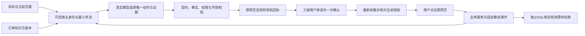

# V1演示与复现

> 公开脱敏说明：本机/服务器位置已改为仓库相对路径或私有配置占位项（`PRIVATE_*_DIR`）；本机私有记录未随仓库发布。原始材料在本机保留，历史命令不构成当前运行或费用许可。

2026-11-06。**V1有限A–F验收通过：真实A/C来自Q35，真实B/D来自Q36，E程序边界与F知识UI复用已验证证据。** M1、M2完成，M3材料本轮绑定真实结果；完整结论见[最终验收与交付](42V1最终验收与交付.md)，费用与运行状态见[STATE](STATE.md)。原研究后置、未验收；有限样本不表示统计可靠率。

作品支持自建模拟差旅v1、合成本人单行程，无真实支付。A/C从已有虚拟付款资料与有效报价开始；B/D复用该任务取得的同一张有效票。用户业务动作由工程用户逐条审读真实建议后在原网页忠实执行；模型不获自动付款或审批权限。

## 作品链路与证据边界

[42执行接线](42V1单行程执行接线与本地验收.md)和[等待推进修正](42等待推进协议修正与续验.md)保留实现依据。模拟worker在忠实完成非终态轮次后推进显式虚拟事件：首付款事件结算并保留已付0票，下一事件出票，合法wait同样可以推进。不注入额外query，不声称墙钟等待会自动出票；错误end、拒绝或重放不推进。

知识复用Q31组合中的旧真实构建成果，来源链为`.local/d3-40/candidate-provenance.json`→`.local/d3-26/releases.json`，保留原观察日期和来源。本次没有新知识训练。运行模型仅收到允许资料、匿名当前状态及必要证据；源码、SQL、隐藏判据和凭证不进入模型。

## 实际验收结果

| 场景 | 取得的证据 |
| --- | --- |
| A 本人持续出票 | Q35真实lock/pay/query/end，同一会话独立一票、唯一付款/扣款110000模拟分、库存2/0/1 |
| B 当前页与导航 | Q36在welcome页求助，模型选择booking并实际调用navigate；原网页DOM、焦点与nonce ACK成功，同一导航会话回执 |
| C 已付待票与重观察 | Q35第3轮付款succeeded、出票pending、无票，查询原付款未重复付；第4轮重新观察有效票后结束 |
| D 未覆盖问题 | Q36对产品未说明的国际签证返回unknown、gap=unsupported，没有编造办理能力 |
| E 身份/事实/期限 | 账号/对象、伪角色、迟到结果、关键事实篡改及新完成时授权反例通过；无越权业务副作用 |
| F 知识发布回滚 | 原管理UI审阅来源→发布→新会话使用→回滚；复用已审核候选和原构建来源 |

Q35的A/C通过后，第5次模型候选导航到trips且缺真实工具，被正式503拒绝，整批永久关闭，D未启动。生成端页面映射/工具协议修正后，Q36仅续验B/D；2次真实请求均通过，前后业务SQL逐值一致，新worker事件和业务写入均0。A/C没有重新收费验收。用户后续“允许新增付费调用，做完它”已替代此前暂不付费选择，决定与具体包绑定见决策记录；所有这些包现已关闭。

Q32/Q33工程或平台确认中断、Q34等待不推进的失败及Q35导航失败均保留，不追认成功。真实通过与零模型工程演练分开记录；不以测试数量替代业务结果。可追踪的[脱敏验收摘要](assets/v1-42/2026-11-06验收摘要.json)和[最终报告](42V1最终验收与交付.md)可在不启动服务时查看。

## 真实模型连续截图

| 检查点 | 实际浏览器画面 |
| --- | --- |
| 付款成功但未出票 | [Q35已付待票](assets/v1-42/Q35真实模型-已付待出票.png) |
| 新状态核对与有效票 | [Q35有效票核对](assets/v1-42/Q35真实模型-有效票核对.png) |
| 当前页导航及回执 | [Q36页面导航](assets/v1-42/Q36真实模型-页面导航.png) |
| 未覆盖问题保留未知 | [Q36保留未知](assets/v1-42/Q36真实模型-保留未知.png) |

票据与扣款由Q35独立SQL（本机私有记录，未发布：`../.local/v1-42/run-04/independent-sql.json`）核验；B/D结果由Q36浏览器记录（本机私有记录，未发布：`../.local/v1-42/run-05/browser-result.json`）和核账/SQL不变记录（本机私有记录，未发布：`../.local/v1-42/run-05/accounting-close.json`）核验。模型自述与截图不单独作为终态判据。本机原始运行物在忽略目录`.local`；公开可追踪材料为本页、脱敏摘要、最终报告与选定截图。

## 工程演练和历史画面

下列画面来自原零模型工程演练，候选为固定脚本，AI成功分母0：[知识来源](assets/v1-42/工程演练-知识来源.png)、[已付待票](assets/v1-42/工程演练-已付待出票.png)、[有效票](assets/v1-42/工程演练-有效票.png)、[导航](assets/v1-42/工程演练-真实导航.png)、[未知](assets/v1-42/工程演练-未知.png)、[知识回滚](assets/v1-42/工程演练-知识回滚.png)。

历史真实局部画面：[Q33锁价](assets/v1-42/Q33真实模型-锁价.png)、[Q34付款](assets/v1-42/Q34真实模型-付款.png)、[Q34已付待票](assets/v1-42/Q34真实模型-已付待出票.png)、[Q34等待](assets/v1-42/Q34真实模型-等待.png)。Q34最后仍无票，与原SQL一致。作品采用实际连续截图；当前未安装ffmpeg，无需为展示增加录像依赖。

## 零新增费用的工程复现

**公开克隆边界：** 仓库不发布原PostgreSQL数据目录、`.local`工具/配置、费用账本或原始运行记录。下面的零新增费用B/D工程复现依赖作者原有私有运行环境及Q35实际有效票；仅克隆公开仓库不能直接执行该复现。公开结果可通过随仓库发布的最终报告、脱敏JSON和截图查看，不能为补齐私有初态自动重做收费验收。

查看上述材料无需运行命令。确需验证当前页面链路时，使用原目录`.`、原`.venv`、项目内`.local/reinstall/tools/node`和现有前端依赖。先读STATE确认8000/5173/55433空闲；原55432数据保护，禁止reset。当前脚本会核验55433中Q35同一张实际有效票，复用原数据，仅演练B/D两会话，禁止业务写入、worker推进、真实模型发送和费用预留。票据缺失时应停止并核对恢复材料，不能重做A/C凑初态。

以下`lab-readonly-next`必须是尚不存在的新标签；所有终端从原仓库进入，不覆盖旧目录：

~~~powershell
# 终端一：启动零模型工程宿主和原测试PG
Set-Location -LiteralPath '.'
.\.venv\Scripts\python.exe -X utf8 scripts/v1_task.py rehearsal lab-readonly-next

# 终端二：启动原网页，仍只监听本机
Set-Location -LiteralPath '.'
. .\scripts\use-project-tools.ps1
Set-Location -LiteralPath './apps/web'
npm.cmd run dev -- --host 127.0.0.1

# 终端三：原网页B/D演练，两次脚本候选不计AI验收
Set-Location -LiteralPath '.'
& .\.local\reinstall\tools\node\node.exe apps/web/tests/v1-execution42.mjs lab-readonly-next
# 完成后正常退出宿主/测试PG；原数据和日志保留
New-Item -ItemType File -Path .local/v1-42/lab-readonly-next/server.stop
# 终端二按Ctrl+C关闭本次Vite，核对退出与端口状态
~~~

这不是重新调用模型验收。已关闭Q32–Q36及更早包的init/live命令均属历史，不可重放或续用余量。若以后确需新的收费实验，应先核对当时的明确范围、预算和授权；本页不授予新调用许可。

## 完工边界

V1有限A–F已通过，M1/M2完成，M3截图、结果与复现材料在本轮绑定；最终收尾见[最终报告](42V1最终验收与交付.md)。当前没有为V1新增模型验收的必要。自主探索、双行程最优性、全面版本适配、完整公平对照及本地8B/微调仍是后置研究，未验收，不自动启动。
