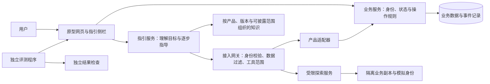
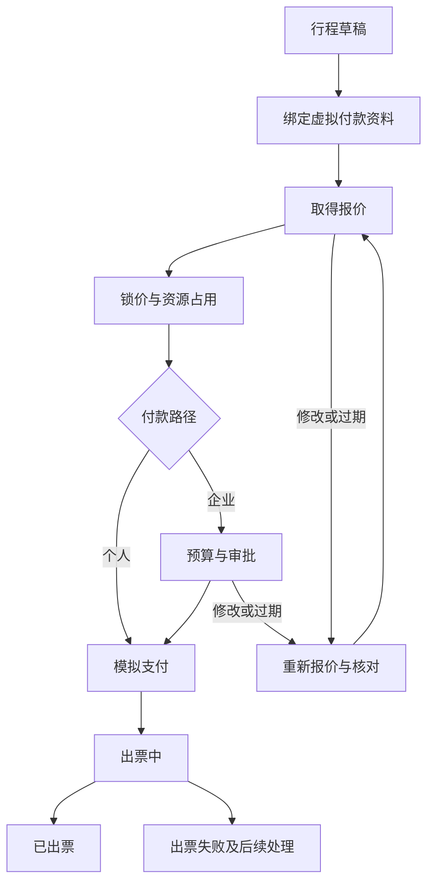

**个性化操作指引助手：开发总指南**

> 2026-10-29修订：用户已选择“先交可展示作品，研究实验后置”，见[QDIR-01](决策记录.md#qdir-01)与[V1作品交付计划](V1作品交付计划.md)。近期V1范围以新计划为准；下方原要求和设计保留为追溯与后续研究目标，不代表全部是V1前置，也不代表已验收。

> 2026-10-11修订说明：用户新增[Q11](决策记录.md#q11-回归llm主线与跨页面工具助手)。近期优先真实LLM实验；跨页面常驻咨询、当前页面感知与受控主动导航改为必做，管理员具备知识构建式“训练”及版本上线。本文旧“定位可选/纯指导/自动代操作排除”在导航定位部分被替代，业务自动付款等仍未授权；原始正文保留追溯。具体新契约见[LLM主线调整](LLM主线调整.md)，实际完成状态查STATE。

版本：v0.1 ｜ 日期：2026-09-26 ｜ 状态：开发方案，尚未实现。技术栈、原型业务规则和阶段规模均为建议，不代表已完成或已经得到效果验证。

本指南落实 [需求定义](需求定义.md)，集中回答“怎么开发”“用什么复杂系统验证”“AI 怎样合法地观察和探索”。详细规则见本文的 [附录 A：原型系统与场景规格](#prototype) 和 [附录 B：AI 接入、身份与探索契约](#integration)。

**1. 开发目标与关键决定**

建设一个有真实状态变化的复杂原型，以及一个独立运行的指引助手。用户在原型内正常操作；助手通过明确的产品接口和资料理解当前情况、规划下一步，并在必要时使用无业务副作用的预演或隔离沙盒探索。

推荐原型为“模拟差旅工作台”，包含出行预订、付款方式、动态报价、审批、模拟支付、出票及异常恢复。它自然覆盖多身份、多步骤、顺序相关和延迟显露功能。名称和题材可以替换，但应保留这些复杂性。

支付、身份验证、库存供应商、出票都用虚拟数据和模拟服务，不接真实资金或真实银行卡。隐藏价格等规则是故意构造的实验条件，不代表现实机票业务规则，也不是面向消费者的产品设计建议。

核心决定：

- 原型的状态、权限和操作后果需要真实执行；外部业务服务可以模拟。
- 助手与业务系统分进程运行，通过接入接口协作；不向助手提供业务源码或数据库连接。
- 用户侧助手按当前用户获得有限权限；另设探索管理能力，在隔离沙盒里使用不同模拟身份走流程。
- “知道流程”“获知当前用户的数据”“执行操作”分别授权。
- 先完成一条从问题到任务结果的完整流程，再增加复杂性；不先做通用平台或训练大模型。

**2. 应有的系统组成**



图中是职责划分，不要求全部部署成独立微服务。初期只需业务服务、指引服务和数据库；网关、适配器、知识访问可作为指引服务中的独立模块。隔离探索增加单独环境，评测在开发环境独立运行。

| 模块 | 负责什么 | 不负责什么 |
| --- | --- | --- |
| 原型网页 | 登录、业务操作、展示状态、与助手交互 | 不根据前端传入的角色自行决定权限 |
| 业务规则层 | 验证动作、改变状态、计算规则、保证重复提交不重复生效 | 不依赖模型判定订单或权限是否有效 |
| 模拟外部服务 | 返回可控的报价、付款、出票结果，注入延迟或失败 | 不接真实银行和供应商 |
| 产品适配器 | 将产品的资料、可公开状态和能力映射到约定格式 | 不返回源码、完整数据库或测试标准答案 |
| 接入网关 | 解析身份、检查对象权限、过滤结果、限制探索范围 | 不让模型自行选择生产管理员身份 |
| 指引服务 | 理解目标、询问信息、选择工具、生成步骤、处理反馈 | 不直接修改业务数据库或绕过业务规则 |
| 探索服务 | 创建受控副本、按模拟身份试走、返回带条件的观察结果 | 不将沙盒结果写回用户业务会话 |
| 知识维护 | 收集发布资料与验证过的观察，维护版本、适用性和来源 | 不把模型的推测自动升级为确定事实 |
| 评测程序 | 设置任务、按步骤操作、观察终态、计算结果 | 不把解题脚本、预期终态或管理员接口交给助手 |

**3. 系统与 AI 应该耦合到什么程度**

用户身份、流程状态、版本和操作结果需要准确对接。推荐在这些语义上深度集成，通过有限接口传递信息。

代码与部署保持分离：业务系统发布自己的能力和状态接口，指引服务使用产品适配器读取。业务产品没有 AI 时仍可操作；替换模型不会要求修改订单规则；更换接入产品时主要修改适配器和产品资料。

建议分三层发展：

| 接入层次 | 提供的信息 | 用途 |
| --- | --- | --- |
| 文档接入 | 经过筛选的文档、版本说明与用户反馈 | 建立基础对照，证明仅凭文档的能力和局限 |
| 状态接入 | 当前页面、允许读取的资源、当下操作及条件 | 首版主要工作方式，支持准确跟进 |
| 探索接入 | 预演接口、隔离副本、模拟身份和操作记录 | 验证隐藏分支和顺序影响，是后续重点 |

不要把所有完整流程和最优路线直接写成返回给助手的接口。如果业务接口已经返回答案，应将其标记为人工规则辅助，不能宣称模型自主发现了路线。适配器也不应按评测题编号返回特制步骤。

**4. 推荐技术组合与选择理由**

| 部分 | 首选建议 | 原因 |
| --- | --- | --- |
| 网页 | React + TypeScript | 构造表单、订单页和助手侧栏；保持界面简单 |
| 业务及指引服务 | Python + FastAPI，两个独立服务入口 | 便于模型实验与接口开发，职责和访问权限可以分离 |
| 数据库 | PostgreSQL | 原型需要事务、多个用户和并发状态检查；初期只需一个实例及隔离数据库或账户 |
| 模型调用 | 自己定义小型统一接口，适配已有模型服务 | 固定请求、用量、超时和结果格式，便于换模型做对照 |
| 后端验证 | pytest | 检查业务规则、状态转换、授权与接口契约 |
| 网页流程验证 | Playwright | 模拟用户操作，记录页面与运行轨迹 |
| 知识检索 | 先用结构化功能索引及文本搜索 | 在规模和错误分析证明有必要后再加入向量检索 |

参考：[React](https://react.dev/learn)、[FastAPI 身份认证示例](https://fastapi.tiangolo.com/tutorial/security/oauth2-jwt/)、[PostgreSQL 事务说明](https://www.postgresql.org/docs/current/transaction-iso.html)、[pytest](https://docs.pytest.org/en/stable/)、[Playwright 定位文档](https://playwright.dev/docs/locators)。这些工具解决通用开发工作，业务授权和指引规则仍需自己实现。实际开工时验证兼容性并固定依赖版本，不追逐每个组件的最新版本。

初期不引入 Kubernetes、多个消息中间件、复杂分布式编排或多智能体分工。异步模拟任务可先通过任务表和一个工作进程运行；身份规则先用明确、可测试的代码表示，不以接入额外权限框架为前提。

**5. 推荐代码组织**

下面是未来结构建议，本次只创建设计文档。

```text
apps/
  prototype-web/         原型界面和指引侧栏
services/
  business/              业务状态、授权、计算与操作接口
  guide/                 对话、计划、观察、知识与模型适配
  explorer/              后续增加的隔离探索协调器
packages/
  guide-contract/        可发布接口结构与客户端类型
adapters/
  travel-lab/            指引侧产品适配，不导入业务内部模块
product-knowledge/
  releases/              已审查、可分发的版本知识包
simulation/
  providers/             虚拟支付、报价与出票
  scenarios/             可重置的原型初始状态
evaluation/
  tasks/                 评价任务与独立结果条件，不挂载给助手
  drivers/               按助手步骤操作的评测执行器
  reports/               原始结果、汇总和失败分类
tests/
  domain/                状态和计算规则
  authorization/         身份、对象、租户和字段隔离
  contracts/             接口、版本和副作用约束
  e2e/                   网页完整任务
docs/
```

业务服务可向前端发布页面所需信息，向指引适配器发布受控信息；二者均经过服务端授权。只有公开契约可以共享，不能因为处于同一代码仓库就让指引服务导入业务私有实现。

**6. 开发顺序与退出条件**

| 阶段 | 实际要完成的工作 | 进入下一阶段前的证据 |
| --- | --- | --- |
| D0 固定实验设计 | 选定原型，确定角色、核心规则、两个版本差异和第一批任务 | 一个角色矩阵、一条人工可执行流程、任务成功判定方法 |
| D1 原型核心 | 登录、订单、付款方式、报价、审批、支付与出票状态；简单界面 | 不用 AI，真人可走通个人及企业两条流程；关键错误可复现 |
| D2 接入与隔离 | 观察接口、功能说明、身份网关、版本字段和日志 | 助手账户不能读源码或数据库；用户间隔离；假身份请求被拒绝 |
| D3 基础指引 | 文档查询、当前状态、目标理解、逐步提示和操作后观察 | 一条完整任务成功；用户偏离路径后能够恢复；同时保留文档问答对照 |
| D4 受控探索 | 先实现纯预演，再增加一个隔离沙盒中的后置分支 | 绑卡后出现报价的流程可被探索；业务会话没有因探索改变；结果明确标记为模拟 |
| D5 身份和版本变化 | 审批过期、切换账号、权限撤销、知识更新与旧版支持 | 旧计划与旧缓存失效；不同版本获得各自路径；不能跨角色复用报价 |
| D6 独立评价与整理 | 固定任务、难度留出、工具预算、运行记录和短演示 | 有可复现对照数据、边界检查及失败案例；结果不是只挑成功截图 |
| D7 可选加深 | 根据错误分类改检索、计划、上下文或小模型训练 | 每项改动都有单独增益或无效结果，能够解释成本与限制 |

两到三周可争取完成 D0–D3 和 D4 的一个代表性场景。完整身份、动态探索、版本变化与并发矩阵应分批扩展，不承诺原先两三周覆盖本次全部新增要求。D3 可用后即可用于初步求职展示，后续持续补实验。

**7. 指引服务的基本循环**

每一轮执行：识别目标 → 获取可信身份与新状态 → 查询适用知识 → 生成候选步骤 → 检查前提与证据 → 必要时预演或探索 → 给出一步指导 → 等待用户操作 → 再次观察。

计划必须允许修改，不能一次生成长路线后不再读取状态。给出的每一步应包含动作目标、可定位的入口、预期结果、依赖的状态版本和依据；用户界面使用简单语言，技术细节留在开发者记录中。

探索设置工具调用次数、分支数、最大深度和耗时上限。达到上限、需要用户本人验证或缺少允许数据时，询问必要信息或给出明确阻碍；不能无限循环，也不能通过提升权限凑出答案。

角色、版本、报价有效期或资源状态变化时，丢弃受影响的待执行步骤。模型服务超时不会改变业务状态；中断恢复时先观察，再决定是否重试。

**8. 知识如何建立和更新**

来源分为产品发布的使用说明、受控能力清单、经过授权的当前观察、探索记录。每条知识保留来源、适用版本、适用角色及条件、观察环境、验证结果、有效期或失效条件。

产品发布资料属于静态说明；当前用户数据按请求读取，不能写进公共知识包。探索得到的经验先保存在候选区，经过重复验证和披露检查后，才可成为通用帮助；用户身份、报价和个人输入不能随经验混入跨用户知识。

版本更新演示至少包含入口移动、前置条件改变和某个分支被删除。发布新知识前运行相关流程，新旧版本分别保留测试。程序接口契约的版本与产品版本分开，防止模型收到旧字段却错误解释为新版状态。

**9. 评测必须分开四种能力**

| 能力 | 如何验证 |
| --- | --- |
| 业务原型正确 | 无模型的规则和流程测试，确认错误来自助手前先排除原型错误 |
| 信息与操作边界 | 程序层检查数据访问、字段过滤、沙盒副作用和身份切换 |
| 指引质量 | 按步骤实际操作并独立检查任务目标、无效操作与恢复情况 |
| 知识更新与探索价值 | 在新角色、新流程变体和新版本中比较有无相关能力的结果 |

建议保留以下对照，使用同一模型、任务与初始状态，记录工具次数和成本：

- B0：文档问答，无实时状态。
- B1：文档加当前用户允许观察的状态与当前动作。
- B2：B1 加受控预演。
- B3：B1 加隔离探索；根据研究问题再另测预演与探索同时启用。

不要在一个版本同时换更强模型、加完整规则答案、增加大量调用预算，然后把所有改善归因于某一个模块。完整契约资料与只给部分观察的任务分别统计，以区分深度接入收益和探索收益。

评测执行器接收助手输出的动作目标，再以用户身份在网页操作；它不访问解题答案替助手选择下一步。它只在允许的模拟场景中操作，和用户侧助手的运行权限分开。独立判定程序可以检查标准状态，但结果条件、正确路径和测试控制接口不暴露给助手。

**10. 实验数据与指标**

任务保存目标、账号、初始状态、产品版本、规则变体、随机种子、虚拟时钟、外部事件安排、允许资料、工具预算和独立成功条件。一次运行保存模型与提示词版本、知识版本、所有观察及其来源、动作建议、实际用户操作和最终状态。

指标至少包含：可完成任务成功率、不可完成任务识别率、步骤有效率、平均操作和询问次数、失败恢复率、模拟结论被误当真实结果的次数、身份/数据边界违规、等待时间与模型用量。允许帮助和受限请求分开计分，不能靠一直拒绝得到高分。

使用未参与调试的角色组合、顺序变体和版本差异作最终评价，不只更换人名或金额。初期可从约 30–50 个场景实例开始，后续组合生成更多实例；数量不能替代难度和覆盖说明。小样本报告分子、分母及多次运行波动，不预设漂亮提升百分比。

真实接入另作检验：核心可用后，选择第二个小型产品或已有软件，通过新适配器接入并记录新增代码和资料维护量。首个自建原型的成绩不能证明已适配任意软件。

**11. 必须提前处理的工程细节**

- 每次业务动作在服务端重新校验权限、前提和对象版本，不能只在生成指引时检查一次。
- 报价、审批和支付结果引用明确的订单版本；修改订单后不能继续使用失效批准。
- 重复请求使用稳定的操作标识，使同一次提交不会重复扣减模拟余额或库存。
- 超时只表示没及时得到结果；查询已有操作状态后再决定下一步。
- 状态写入和事件记录放在同一事务，异步任务由可靠的待处理记录驱动，防止界面显示成功而后台遗漏。
- 模拟时间可推进，异步成功与失败可注入，测试不依赖真实等待和随机网络。
- 缓存至少隔离用户、组织、当前角色、产品版本、权限版本及相关对象版本。失效的数据不继续进入对话摘要。
- 知识输出、日志、报错和截图都是潜在数据通道，所有观察按同一披露规则处理。
- 高权限探索会改变可见路径，因此探索时需要模拟具体用户角色；平台管理员视图不能代表普通用户体验。
- 界面定位优先使用稳定的语义标识和可见名称，禁止依赖隐藏页面变量、源码或评测专用状态。

并发状态并不因为使用数据库就自然正确；需要针对库存、报价和审批绑定设计事务与冲突处理。[PostgreSQL 的事务文档](https://www.postgresql.org/docs/current/transaction-iso.html) 给出了并发观察及隔离行为，具体业务不变量仍由本项目验证。

**12. 求职展示应产出什么**

保留三段短演示：正常用户完成一条任务；顺序或版本变化导致旧计划失效后恢复；助手通过模拟探索发现后续流程，同时说明真实用户仍需要完成哪些前提。

GitHub 提供：一条可运行的启动路径、模拟账号、可复现场景、协议说明、权限矩阵、对照实验、完整失败分析，以及源码与数据隔离的可检查说明。案例中出现的报价和身份全部为模拟数据。

个人贡献应能指向状态模型、接入协议、探索策略、权限控制、评测设计或实际改进。使用现有模型和框架可以明确说明；只有测到稳定问题后才安排微调或推理优化。

**13. 当前仍需在开工时确定**

推荐方案已经足以编写第一轮开发任务，但具体页面样式、模型供应方式、依赖版本和部署机器仍需按环境确认。题材可以变更；多角色、顺序影响、动态后续步骤、隔离探索和独立验收这几类实验能力应保留。不得为了“尽可能完整”在第一轮同时扩展真实支付、多产品、多端和大规模训练。

---

<a id="prototype"></a>

**附录 A：模拟差旅工作台——原型系统与场景规格**

版本：v0.1 ｜ 日期：2026-09-26 ｜ 状态：推荐实验原型，尚未实现。

本附录对应正文开发方案，身份与探索规则见 [附录 B](#integration)。本文中的金额、规则、身份和外部服务全部是人为设计的实验数据，不代表真实旅行、银行或航空业务。所有付款方式都使用虚拟标识，不收集真实银行卡资料。

**1. 为什么选择这个原型**

主线为选择行程 → 绑定虚拟付款资料 → 取得动态报价 → 必要时审批 → 模拟支付 → 模拟出票。它可以在少量页面内产生权限、顺序、资源、异步、版本和隐藏分支问题，适合评价持续指引。

原型需要有真实执行的规则和状态。最底层的报价供应商、支付与出票可以模拟，但不能所有操作都只返回“成功”，也不能由前端任意切换页面就越过条件。

**2. 页面范围**

建议先做登录与身份选择、行程草稿、付款资料、报价与订单、审批待办、出票进度六类页面，右侧复用同一个指引侧栏。简单表单、表格和状态提示即可。

组织配置、财务异常与场景控制可先用简陋的开发者界面。场景控制仅出现在测试环境，不向用户侧助手提供入口和凭证。员工无法通过直接输入审批网址获得权限。

演示登录可以选择预置虚拟账户，但登录后的身份由服务端会话表示；前端传入 `role=admin` 不产生管理员资格。演示登录本身不包装成生产身份认证系统。

**3. 身份与资源矩阵**

| 身份 | 允许的业务 | 关键限制 |
| --- | --- | --- |
| 个人用户 | 创建自己的个人行程、取得个人报价并模拟支付 | 无组织预算和审批权限 |
| 企业员工 | 创建自己的差旅行程、申请预算与审批 | 只能读取自己的订单和必要组织规则 |
| 部门审批人 | 处理同部门且被指派的审批 | 不得审批自己的申请；不读取付款资料详情 |
| 财务人员 | 读取允许的预算、付款状态和异常 | 不自动获得审批、角色分配或个人资料读取权 |
| 组织管理员 | 配置本组织的角色和业务规则 | 管理权限不自动等于所有个人业务资料的读取权 |
| 外部协作者，后续 | 查看明确分享的行程摘要 | 不得沿对象关联读取预算、付款方式或成员目录 |

至少准备两个组织和多个账户，验证同角色在不同组织、部门和资源归属下的差异。同一个人兼具员工和审批人角色时，自己的申请仍不能自行批准。

助手的身份另按接入契约管理。产品探索管理员不等于上表的组织管理员，也不直接成为当前用户的业务操作者。

**4. 核心数据对象**

| 对象 | 必需字段或关系 |
| --- | --- |
| 用户与成员关系 | 用户、组织、部门、角色、成员关系修订号、启停状态 |
| 行程草稿 | 所有人、组织、航段、日期、乘客数量、修订号 |
| 虚拟航段资源 | 标识、实验价格参数、库存与占用数量 |
| 虚拟付款资料 | 所有人、付款类别、实验资格状态、修订号；不包含真实卡号 |
| 报价 | 行程修订、付款类别、价格规则版本、金额、有效时间、状态 |
| 优惠券 | 所有人或允许范围、优惠规则、可用/占用/消耗状态、占用订单 |
| 预算与占用 | 组织及部门、额度、占用申请、占用与释放状态 |
| 审批申请 | 请求人、审批人、行程修订、报价标识、决策与状态 |
| 付款尝试 | 订单、金额、稳定操作标识、提交/处理中/待确认/成功/失败状态 |
| 订单与出票任务 | 行程与报价快照、付款尝试、出票状态、模拟凭证 |
| 产品环境 | 产品版本、规则版本、权限策略版本、功能开关版本 |
| 事件记录 | 工作空间、操作者、对象、操作、前后修订、序号、虚拟时间、结果 |

不要把全部业务状态压成一个总状态。审批通过但报价过期、支付成功但出票失败，都是合法且需要表达的组合。

**5. 后端必须维持的不变量**

1. 每次读取和动作都重新检查身份、组织、资源归属和必要角色。
2. 支付的报价对应当前行程，仍有效；企业路径还必须有适用的批准与预算。
3. 已批准的行程发生实质修改时，相关报价和审批失效。
4. 每张券同一时刻最多被一个有效订单占用，预算与库存不能超额占用。
5. 同一稳定操作标识重复提交只生效一次；标识相同但参数不同必须拒绝。
6. 支付成功不代表出票成功；出票完成才满足“拿到票”的任务目标。
7. 取消或过期按明确规则释放资源；已消费资源不能简单当作未使用资源恢复。
8. 原型业务数据与探索副本相互隔离，探索不增加业务订单、占用或模拟扣款。
9. 每次关键状态变化与其事件记录原子提交，便于排错和回放。
10. 报价和资格尚未知时保存为未知，不以零价格或默认合格代替。

**6. 核心状态转换**

| 动作 | 前提 | 状态及后果 |
| --- | --- | --- |
| 新建/修改行程 | 当前用户有权操作草稿 | 行程修订增加；使依赖旧修订的报价与批准失效 |
| 绑定虚拟付款资料 | 用户本人拥有该虚拟资料 | 产生付款类别；允许申请对应报价；更换类别使旧报价失效 |
| 申请报价 | 行程完整、付款类别已知 | 生成带版本和期限的报价；异步时先返回任务标识 |
| 锁定报价 | 报价有效、资源仍可用 | 原子确定优惠券归属、最终应付额与资源占用，生成不可变的锁价快照并设置期限；与预报价不同的金额需重新向用户展示 |
| 提交企业审批 | 属于企业路径且预算允许 | 创建绑定当前行程修订和锁价快照的申请，预算占用状态生效 |
| 审批决定 | 指派审批人、同部门、非申请人本人 | 通过或拒绝；拒绝时按规则释放相关占用 |
| 发起模拟支付 | 锁价快照及所需批准有效，金额与该快照匹配 | 建立付款尝试；可能处理中、失败、成功或结果待确认 |
| 查询付款状态 | 当前用户可读该尝试 | 返回已知状态，不重复发起付款 |
| 出票结果到达 | 已支付成功 | 变成出票成功或出票失败；生成虚拟凭证或进入后续处理 |
| 取消/重新报价 | 当前状态允许撤销 | 释放可释放的占用，创建新修订或新报价，不伪造回到旧状态 |

报价申请、锁定和审批不是无副作用的读取。即使某个实现使用 HTTP GET，也不能因此把它当作允许助手随便执行的只读查询。



图为主要路径，真实实现还需保留每个对象的独立状态和失败分支。

**7. 用户提出的“先操作才知道后面有什么”**

V1 实验规则：绑定虚拟付款资料前，页面不显示可确认的价格，报价接口返回 `requires_payment_profile`。资料类型为 `demo_personal` 或 `demo_corporate`，由服务端检查后返回付款类别。

假设一个单航段场景中：基础价为 1,000，固定费为 100，合格企业付款类别减免 100。则个人报价为 1,100，企业报价为 1,000。这只是该场景下的测试数据。

V1 进入企业报价后才显露“选择预算项目”和“提交部门审批”；个人路径显示相应的个人支付步骤。V2 将预算项目选择提前到报价前开放，满足新增报价条件后再进入审批，避免形成前置条件循环。某些实验变体还在后续显示附加材料条件，不能只靠首次页面的按钮列表完成整个流程。

助手可以提前知道“需绑定合格方式后才能报价”，但未获取当前用户付款类别前不能断言其准确价格。探索管理员能够创建虚构企业用户走通分支，得到的是带该身份与条件的模拟结果；当前用户仍需完成自己的前置步骤。

**8. 顺序不同导致不同结果：必须保留的两个例子**

例一：两段行程共用一张优惠券。

本场景为独立实验配置，全部基础应付额为 1,000 和 600，不叠加第 7 节的费用。券打八折、最高减 200；第一个锁价的合格订单自动占用券，成功支付后消耗，取消锁价则释放。

| 顺序 | 计算 | 总额 |
| --- | --- | --- |
| 先锁定 1,000，再锁定 600 | 1,000 - 200 + 600 | 1,400 |
| 先锁定 600，再锁定 1,000 | 600 - 120 + 1,000 | 1,480 |

锁价前的预报价不保证优惠券已经归属；锁价时原子决定优惠和最终金额，后续审批与支付绑定同一不可变锁价快照。这能检验助手是否把两个目标一起规划。取消并重排只能在未支付、券未消耗且资源条件仍允许时进行；不能默认原库存永远保留。

例二：修改行程与审批的顺序。

先批准再改日期会使批准失效；先改日期再提交审批则可以进入后续流程。批准记录保存对应的行程修订和报价标识，后端拒绝用旧批准支付新行程。助手从聊天记忆中读到“已经批准”仍需核对当前状态。

**9. 二十类复杂场景**

P0 是第一版应保留的实验能力，P1 增强工程完整性，P2 属于进一步扩展；不要求一次性实现全部组合。

| 编号 | 阶段 | 场景 | 期待的系统与助手行为 |
| --- | --- | --- | --- |
| S01 | P0 | 员工与审批人权限不同 | 后端拒绝员工审批；助手识别所需角色并指导正确交接 |
| S02 | P0 | 相同角色、不同资源所有者或组织 | A 看不到 B 的订单和私有状态，所有关联读取同样受限 |
| S03 | P0 | 绑定资料后才有报价 | 保留未知状态，探索结果注明假设，用户完成条件后再给实际报价 |
| S04 | P0 | 身份触发不同后续路径 | 企业与个人分别出现预算审批或个人支付流程 |
| S05 | P0 | 操作顺序改变优惠总额 | 重现 1,400 / 1,480 的不同结果，不能把两件任务孤立规划 |
| S06 | P0 | 修改使审批失效 | 检查当前修订，重新报价和审批 |
| S07 | P0 | 报价与占用过期 | 推进模拟时间后旧报价失效，助手重新核对可用路径 |
| S08 | P0 | 支付与出票分开 | 指引保持在等待或异常处理，直到实际达到出票目标 |
| S09 | P1 | 同人兼任申请人和审批人 | 角色齐全仍禁止自批，转交另一名合格审批人 |
| S10 | P1 | 多人争用部门预算 | 另一申请占用后余额改变，提交端防止超额 |
| S11 | P1 | 最后一个名额并发争用 | 至多一方成功占用，失败方重新规划 |
| S12 | P1 | 重复点击与重试 | 同一操作只生效一次，不重复订单或付款 |
| S13 | P1 | 支付已成功但响应丢失 | 显示待确认并查询原付款尝试，避免重复发起 |
| S14 | P1 | 取消与资源释放 | 按规则释放库存、券和预算，区分未消费与已消费 |
| S15 | P1 | 用户另一窗口修改状态或切换账号 | 旧请求晚到结果被丢弃，旧计划和个人缓存失效 |
| S16 | P1 | 两个产品版本 | 入口及业务前提真实改变，新旧版分别指导 |
| S17 | P2 | 同版本不同功能开关 | 组织 A 有批量功能、B 没有，不能仅凭版本套用 |
| S18 | P2 | 分享与跨角色交接 | 协作者只能读取允许摘要；待办交接有清楚完成条件 |
| S19 | P2 | 多跳后才出现额外条件 | 特定组合在后续返回附加材料或审批要求，助手逐步修正 |
| S20 | P2 | 出票后的修改或取消 | 作为新的任务处理，遵循已消费资源和补偿规则 |

除这些业务场景，还需接入文档中的权限、源码隔离、预演无副作用和评测答案隔离检查。

**10. 两个版本如何产生实质差异**

| 内容 | V1 | V2 |
| --- | --- | --- |
| 付款资料入口 | 订单页中的付款设置 | 账户中心的付款资料页 |
| 企业报价条件 | 已绑定合格虚拟企业资料 | 还需要当前有效的部门预算项目 |
| 审批有效性 | 绑定行程和报价 | 额外绑定预算项目修订；预算调整可能导致重新审批 |
| 一个旧流程 | 在订单页修改付款类别 | 新版移至付款资料页，并重新计算报价 |

适配器提供版本化映射与正确状态，指引服务的核心循环不应为每道 V2 测试题增加硬编码。最后评价保留未参与调试的变体，例如另一入口迁移、不同条件组合或功能关闭。

**11. 模拟什么，实际实现什么**

| 可模拟的外部能力 | 必须实际执行的内部行为 |
| --- | --- |
| 航班与供应商数据 | 对象归属、可见范围与角色检查 |
| 银行资料验证 | 付款类别对路径和计算结果的影响 |
| 报价、支付、出票服务响应 | 报价有效期、状态流转和异步结果 |
| 邮件短信，改写为模拟通知列表 | 通知对应的任务是否真正建立 |
| 简单票据凭证 | 已出票与未出票的独立完成判定 |
| 假的时间和网络延迟 | 到期、重试、取消、占用与释放规则 |

页面美术、真实搜索数据、真实支付、完整财务报销和复杂管理后台均不在第一轮重点内。

**12. 可重置与故障注入**

每次运行创建独立工作空间，至少隔离订单、预算、券、库存、异步任务和缓存。固定初始快照、随机种子和虚拟时钟；失败后从相同条件重新运行。

测试控制器可设置“第二次报价失败”“支付成功但响应丢失”“出票任务在第 3 个事件后完成”，也可推进时间以触发报价过期。控制器只能被评测和探索基础设施使用，不能列入用户侧助手的工具。

示例场景描述只供测试系统读取，不能作为知识喂给模型：

```json
{
  "scenario_id": "S05-large-then-small",
  "seed": 17,
  "product_version": "v1",
  "rule_version": "coupon-order-1",
  "clock": "2026-09-26T09:00:00Z",
  "workspace_template": "two-trips-one-coupon",
  "user_fixture": "personal_alice",
  "external_events": [],
  "goal": "为两个行程取得模拟机票，并在固定价格、库存和优惠规则下使总支出最低",
  "evaluator_only": {
    "ticket_count": 2,
    "total_paid": 1400,
    "duplicate_payment_count": 0
  }
}
```

标准终态与正确路径由评测进程持有；助手只获得允许的用户目标和当时能观察的状态。业务事件可以确定性复现，模型文字不承诺每次逐字一致。

**13. 原型完成的判断**

第一版应能由人工走通个人和企业流程，复现 P0 场景，并由测试程序检查金额、权限和终态。支付成功/失败、身份变化或版本变化必须改变实际后端行为。

接入 AI 前保留人工参考运行；接入后所有成功和失败都能回放到对应的业务状态。真实业务动作的服务端约束不得因“给 AI 演示”而临时关闭。

---

<a id="integration"></a>

**附录 B：AI 接入、身份与探索契约**

版本：v0.1 ｜ 日期：2026-09-26 ｜ 状态：建议接口与行为约定，尚未实现。

本附录对应正文开发方案，业务规则见 [附录 A](#prototype)。接口路径、字段和名称可在实现时统一调整，但身份分离、来源标记、状态有效性及副作用约束应保留。

**1. 如何理解“AI 需要特殊管理员”**

助手确实需要一种能力，去了解普通用户当前页面之外的后续流程。建议提供专门的探索管理身份，用于创建和重置测试空间，并以不同的模拟用户角色验证路径。

它获得的是探索设施的管理权限，不意味着用户侧助手长期拥有业务系统的全部权限。管理员可能跳过普通用户的审批、看到不同的菜单或使用不同价格，直接复用其路线会产生错误指导。

| 身份 | 环境 | 允许的能力 | 不可混用的能力 |
| --- | --- | --- | --- |
| 探索管理员 | 探索控制环境 | 创建隔离副本、选择获准模拟身份、推进测试时间、重置 | 不访问当前用户之外的业务资料，不直接执行用户订单操作 |
| 模拟用户 | 隔离副本 | 按个人、员工、审批人等角色走流程 | 不把模拟资格、报价或批准当作当前用户的事实 |
| 当前用户的指引助手 | 用户业务环境 | 读取当前用户允许的必要信息、核对步骤和提供指引 | 不继承探索管理员权限，不自动绑定资料或支付 |
| 用户本人 | 用户业务环境 | 在实际界面完成被授权操作 | 操作授权不因为对话建议而自动转交给助手 |
| 独立评测身份 | 仅测试环境 | 设置场景、执行测试用户操作、读取终态判据 | 标准答案、内部状态和控制令牌不发送给助手 |

产品结构中公开可说明的后续步骤，可以在当前用户尚不能执行时提前解释；受限制的功能存在、条件或数据则按披露规则处理。能讲解某个流程与能替用户执行该流程是两种权限。

**2. 不同登录用户如何对应不同 AI 身份**

保留两个身份字段：实际发起服务调用的助手服务，以及它当前代表的用户。服务端还需维护组织、当前成员身份、权限修订、任务范围、环境、会话有效期和可用工具。

有效的用户数据访问与操作能力是以下约束的交集：

`助手允许使用的工具 ∩ 当前用户权限 ∩ 本次委托范围 ∩ 对象归属与当前状态规则`

探索管理权限不会并入该集合。公开流程知识的访问单独受产品发布与披露规则约束，不必机械地限制为“当前页面正在显示的按钮”，但也不能借此取得私有业务数据。

身份由服务端会话解析；模型提供的 `user_id`、`tenant_id`、`role` 或文本自称不能改变授权。模型可以请求查看某个对象，但服务端必须检查该对象是否属于当前用户可访问范围。

这一概念可以参考 [RFC 8693 中的主体与代理身份区分](https://www.rfc-editor.org/rfc/rfc8693.html)。首版不要求搭完整 OAuth 基础设施；可使用成熟认证库与应用内短期会话实现服务端身份绑定，不自行发明加密算法。

**3. 将信息可见性拆开**

| 维度 | 例子 |
| --- | --- |
| 可知道功能存在 | 普通用户可以知道企业付款功能存在，但不一定能使用 |
| 可了解条件 | 可以说明需要企业成员资格；不能泄露内部风控细则 |
| 可读取当前数据 | 可以看到自己报价；不能读取另一用户的付款资料 |
| 可执行动作 | 员工可提交申请，指定审批人才能审批 |
| 可探索模拟结果 | 能在获准测试角色下观察某种分支；结果带模拟标签 |

上述维度由产品策略决定。可见、可执行、可预演和已完成应使用不同字段，不用一个 `allowed=true` 混合表达。

权限检查可先通过纯函数与明确规则实现；[OPA 的集成设计](https://www.openpolicyagent.org/docs/integration) 可参考其把授权决策与业务处理分离的思路，本项目不要求先部署 OPA。

**4. 三种获取后续知识的方式**

优先读取已发布的流程说明。需要计算或观察时，按能力使用预演或隔离探索；缺乏必要真实信息时由用户继续操作。

| 方式 | 输入 | 输出 | 约束 |
| --- | --- | --- | --- |
| 流程说明 | 产品、版本、允许的身份上下文 | 功能意义、前置条件、公开的可能分支 | 不是当前用户已取得资格或价格的证明 |
| 服务端预演 | 当前允许状态及显式假设 | 条件判断、估算结果、可能变化 | 无业务副作用；不能保证时返回不支持 |
| 隔离探索 | 合成或获准脱敏的初始状态、模拟身份 | 实际试走轨迹和观察到的分支 | 只影响隔离副本；不复制真实凭证，不把模拟状态回写业务环境 |

如果精确价格需要真实账户资料，三种方式都不能替代尚未发生的真实资格核验。可以告诉用户下一步如何得到报价，不能把一个模拟账户的金额包装成用户报价。

**5. 预演的“无副作用”具体指什么**

不得新增业务订单、占用库存或预算、消耗优惠券、改变账户绑定、发送真实通知，或触发会产生这些效果的后台任务。仅回滚数据库不足以阻止已经发出的外部调用。

预演可以留下独立技术审计记录和消耗明确的探索计算预算；这些必须与业务资源占用分开。模拟结果必须标记假设、适用环境、有效性条件和缺失信息。

实现方式优先为受约束的计算函数或只读投影。若调用链含未知外部副作用，返回 `preview_not_supported`，改用隔离环境或指导用户本人操作。

可借鉴 [Kubernetes 服务端 dry-run](https://kubernetes.io/docs/reference/using-api/api-concepts/#dry-run) 的约束思想：验证和处理可以发生，持久化被禁止，无法安全执行的路径需要拒绝。引用是设计参考，不意味着本项目已经获得同等保证。

验收时比较调用前后业务对象、库存、预算、券、模拟扣款次数、通知和后台任务，检查是否变化。只看接口声明或日志中的 `dry_run=true` 不足以证明正确。

**6. 隔离探索怎么实现**

由探索控制器在独立工作空间初始化相同版本的业务规则和外部服务替身。探索可以与业务原型使用相同程序镜像，但数据、凭证、资源占用和外部目标必须隔离；指引服务仍不能读取该程序源码。

不在业务数据库内凭一个 `is_test` 参数切换所有限制。推荐单独数据库或严格隔离的数据库账户与工作空间，探索环境只连接模拟供应商，网络出口不能连真实支付或通知服务。

探索按具体模拟角色运行。创建副本的管理员不直接用管理员角色走员工路线；需要知道不同身份的效果时创建不同分支。没有权限模拟的角色，模型不能通过请求参数申请到。

探索观察在返回用户侧模型前，必须同时满足受测角色的可观察范围和当前接收用户的可披露范围，由程序实际过滤，不能仅附加标签。每条分支保存初始快照、产品与规则版本、模拟身份及属性、种子、虚拟时间、输入、动作顺序、观察和未验证部分。分支之间单独重置，避免前一条路径占用的券污染后一条结果。

将当前用户的允许状态映射到副本时，只复制必要字段；无法复制的资格、外部事实标为假设或未知。首版原型全为模拟数据，也要保留这项区分，以便验证迁移到真实产品时的边界。

探索工具设置配额和最长运行时间。释放副本后保存经过筛选的证据，清理临时数据。没有“把探索后的状态应用到业务环境”的接口。

**7. 建议接口**

以下路径表示职责，具体 HTTP 设计可调整。所有业务对象参数先做服务端授权；身份来自可信会话，不接受模型自由指定的角色。

| 接口 | 用途 | 副作用分类 |
| --- | --- | --- |
| `GET /guide/context` | 返回服务范围、认证派生的身份视图、产品/策略版本、委托范围 | 业务只读 |
| `GET /guide/capabilities` | 返回允许知道的功能、当下可用性和可公开的条件 | 业务只读 |
| `GET /guide/observe` | 返回必要的页面、对象状态、语义控件和状态版本 | 业务只读 |
| `POST /guide/check-step` | 检查某一步当前能否执行及可公开的阻碍；不执行 | 业务只读 |
| `POST /guide/preview` | 在支持的流程中计算明确假设下的结果 | 验证过的无业务副作用计算 |
| `GET /guide/events` | 按游标获取当前用户允许的状态与权限变化 | 业务只读 |
| `POST /guide/verify-goal` | 检查允许的目标谓词，如自己的订单是否出票 | 业务只读；不是评测标准答案接口 |
| `POST /exploration/sessions` | 创建允许范围内的隔离副本与模拟身份 | 仅改变探索空间 |
| `GET /exploration/{id}/observe` | 读取某一副本中的允许观察 | 探索只读 |
| `POST /exploration/{id}/act` | 在副本内调用有限的业务动作 | 仅改变探索空间 |
| `POST /exploration/{id}/dispose` | 释放当前获准副本 | 仅改变探索空间 |

`verify-goal` 只接受已支持、与当前用户对象有关的目标类型，不允许执行任意代码，不接收评测任务 ID 来查标准答案。业务动作接口仍由用户界面调用；助手侧不因知道其名称就获得执行凭证。

在某些实验中，能力接口只返回当前可见步骤，深层步骤需探索后获得；另一些实验允许完整公开描述。两种接入条件分别记录与评价。

**8. 返回数据的统一元信息**

| 字段 | 含义 |
| --- | --- |
| `product_id` / `product_version` | 哪个产品和版本 |
| `contract_version` | 接入字段与接口含义的版本，独立于产品版本 |
| `rule_version` / `policy_version` / `feature_config_version` | 业务计算、授权与功能开关所使用的版本 |
| `state_versions` | 本次依据的相关对象修订，不能只靠一个陈旧页面标识 |
| `source_kind` | `documented`、`observed`、`preview`、`sandbox_observed`；推测另标 `unverified` |
| `evidence_id` | 可追溯的观察或文档引用，服务端控制其可见范围 |
| `observed_at` / `valid_until` | 观察时间及有效期；无法给定期限时说明使用前重查 |
| `disclosure_scope` | 可向谁表达，不能由模型修改 |
| `assumptions` / `unknowns` | 尚未满足或无法确认的条件 |

模型请求中不包含真实会话令牌或探索管理凭证。内部身份字段不需要全部暴露给模型，但网关必须保留足以授权和审计的上下文。

示例：绑定付款资料前的用户观察。金额为 `null` 表示尚未知，不是免费。

```json
{
  "product_id": "travel-lab",
  "product_version": "v1",
  "contract_version": "1.0",
  "rule_version": "pricing-1",
  "policy_version": "policy-3",
  "feature_config_version": "features-1",
  "state_versions": {"trip": 4, "membership": 2},
  "source_kind": "observed",
  "evidence_id": "obs-012",
  "observed_at": "2026-09-26T09:00:00Z",
  "valid_until": null,
  "disclosure_scope": "current-session",
  "assumptions": [],
  "unknowns": ["payment_class", "quote_amount"],
  "data": {
    "trip_id": "trip-17",
    "price": null,
    "price_status": "requires_payment_profile",
    "current_actions": [
      {"id": "payment_profile.open", "availability": "enabled", "ui_anchor": "payment-settings"}
    ]
  }
}
```

示例：同产品某个企业测试身份下的探索结果。相同金额不证明适用于当前用户。

```json
{
  "product_id": "travel-lab",
  "product_version": "v1",
  "contract_version": "1.0",
  "rule_version": "pricing-1",
  "policy_version": "policy-3",
  "feature_config_version": "features-1",
  "state_versions": {"trip": 4, "payment_profile": 1},
  "source_kind": "sandbox_observed",
  "evidence_id": "sandbox-021-step-3",
  "observed_at": "2026-09-26T09:00:00Z",
  "valid_until": null,
  "disclosure_scope": "public-procedure-with-assumptions",
  "assumptions": ["synthetic_corporate_member", "eligible_demo_corporate_profile"],
  "unknowns": ["current_user_eligibility", "current_user_quote"],
  "data": {
    "quote_amount": 1000,
    "currency": "DEMO",
    "next_actions": ["budget.select", "approval.submit"],
    "business_session_modified": false
  }
}
```

第二个结果可以支持“企业测试路径下一步需要预算和审批”的条件性说明，不能支持“你的价格是 1,000”。`business_session_modified=false` 只是返回声明，仍需独立检查无业务副作用。

**9. 模型输出与界面展示的契约**

助手每次输出一个短解释和结构化下一步，至少含动作标识、目标控件或路径、依赖状态版本、预期结果、依据与未确认条件。模型不能自造身份或工具权限。

网关在展示前检查步骤标识属于允许范围、引用证据可见且未过期、相关用户会话未切换。金额、状态等关键事实优先由经过验证的结构化字段填入界面，避免模型改写成不同数字。

这些检查只能覆盖明确的契约与事实，不构成对自由语言永不错误的保证。测试仍需检查不当暗示、错误推断和语义泄露。

用户界面区分“已观察”“按当前条件预估”“在测试环境验证过”“尚需确认”。普通指引不展示内部角色令牌、策略表达式、调试字段或实现细节。

**10. 状态、身份与缓存失效**

订单修改、权限撤销、报价到期、版本或功能开关改变，都会使相关计划失效。步骤执行前由业务服务重新校验，助手也应刷新观察；前一刻可执行不代表此刻仍可执行。

切换账号或退出时撤销旧上下文，清除个人会话数据，取消或隔离在途模型/工具请求。晚到结果按会话代次检查并丢弃，不能显示给新用户。调用完成后、送入模型前和展示前都检查当前授权及有效性。

缓存键至少考虑产品、版本、规则与策略版本、用户/组织隔离、当前角色、对象修订与必要功能配置。公共流程知识可以共享，私人报价不能仅按问题文本或角色名缓存。

会话摘要继承原数据的身份和披露限制，撤销或过期时连同摘要失效。权限撤销前已经合法展示的内容不能被系统从用户记忆中收回；这里要求阻止后续继续访问和串用。

**11. 失败与不确定状态**

| 状态 | 助手行为 |
| --- | --- |
| `unsupported_version` | 说明支持范围，不自动使用新版路径 |
| `insufficient_observation` | 询问必要信息或请求允许的最新观察 |
| `not_visible` | 按策略给通用说明，不泄露受限功能或对象是否存在 |
| `precondition_not_met` | 解释允许公开的前提并建议可行步骤 |
| `state_changed` | 刷新状态，取消受影响的旧步骤 |
| `preview_not_supported` | 选择隔离探索或让用户完成真实前置操作 |
| `pending` / `outcome_unknown` | 查询已有任务或操作结果，不当作失败重新提交 |
| `exploration_budget_exceeded` | 停止探索，说明已确认与未知部分 |
| `session_changed` | 丢弃旧上下文和结果，不继续回答旧用户资料 |

内部错误堆栈、数据库内容和凭证不原样传给模型。对隐藏对象的存在性、返回码和原因文字采用一致策略，避免通过报错绕过披露限制。

**12. 源码与测试数据隔离**

业务服务持有业务源码与数据库权限；指引服务只挂载自身代码、允许的产品知识和契约客户端。产品源码、构建脚本、源映射、任意数据库查询和反编译能力不在助手工具范围。

普通浏览器加载和执行页面脚本与助手读取源码是不同能力。适配器只提取允许的界面语义，不向模型转发页面脚本、隐藏状态对象或完整网络响应。

探索环境也通过相同公开业务接口与界面观察进行操作。测试初始化程序可以读取场景配置和内部状态，但与模型调用环境分开，不能将标准答案、期望金额或隐蔽分支列表意外装入提示词。

**13. 接入验收清单**

- 当前用户指引凭证不能调用探索管理接口；受限探索请求由可信网关单独换取限定探索会话。
- 模型伪造角色、组织、对象编号不能扩大访问范围，关联资源也要逐个验证。
- 已公开的后续流程可以解释；受限制的存在、条件、数据不能通过帮助接口泄露。
- 员工与管理员在同一任务上的路线按各自规则产生，禁止把管理员绕过步骤当作优化。
- 预演前后业务订单、库存、预算、券、通知和异步任务不改变。
- 沙盒付款只改变沙盒，沙盒令牌不能访问业务环境，业务令牌不接受沙盒对象编号。
- 模拟结果始终保留来源及假设，未知资格不被默认补成合格。
- 账号切换、权限撤销、版本改变后，旧缓存、摘要和晚到结果不再用于新回答。
- 任务状态为待确认时先查询原操作，重复请求不产生第二次业务效果。
- 助手无法读取源码、数据库或评测答案；界面字段和工具日志同样按允许范围过滤。
- 关闭某项结构化能力后仍能运行受限模式，并如实报告能力下降，不能偷用评测接口补齐信息。
