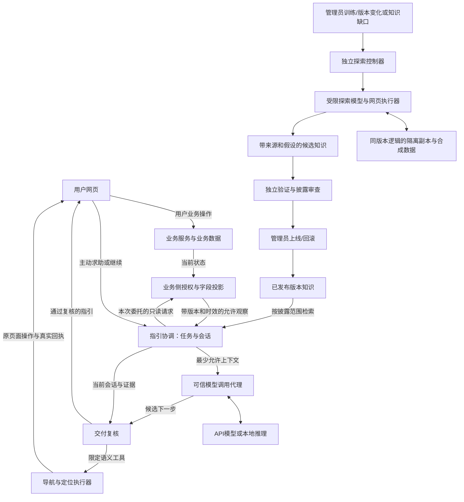

# 项目总览

> 公开脱敏说明：本机/服务器位置已改为仓库相对路径或私有配置占位项（`PRIVATE_*_DIR`）；本机私有记录未随仓库发布。原始材料在本机保留，历史命令不构成当前运行或费用许可。

## V1作品已交付，原研究后置（2026-11-06）

用户明确选择“先交可展示作品，研究实验后置”，正式决定见[QDIR-01](决策记录.md#qdir-01)。当前范围、有限验收与三阶段退出条件只维护在[V1作品交付计划](V1作品交付计划.md)。近期完成真实持续指引、当前页导航、必要身份/事实边界、知识发布回滚和可复现作品；自主探索、双版本全面适配、完整公平矩阵与8B/微调后置。

2026-11-06已按该范围完成M1–M3和有限A–F验收，结果与限制见[最终交付](42V1最终验收与交付.md)。当前无必要V1剩余工作，不重复验收或自动增加费用；原研究仍未验收，后续43仅在用户明确恢复研究后启用。

本次是交付优先级与首版范围调整，不重建差旅底座。下方总体架构仍是长期目标；其中Q2四类能力“全部完成才首次演示”及研究阶段串行门槛不再阻塞V1。原研究未验收部分保留，V1完成不等于原项目整体完成。动作/证据/可信呈现的局部收敛实施选择见计划§2，已由V1-01在原适配器内实现独立证据契约，事实及局限见[41报告](41V1动作证据契约与本地交付.md)和[42执行接线报告](42V1单行程执行接线与本地验收.md)。42复用原网页/业务和连续账本，已完成本地演练与截图；真实验收按STATE，不从零模型票据推断AI完成。

本文件提供阅读入口、范围解释与总体设计边界，不替代原始需求。进度和环境事实只在 [STATE](STATE.md) 维护；正式决定及待决项只在 [决策记录](决策记录.md) 维护。

## 2026-10-11方向调整

用户明确把增加对LLM的理解与可验证能力作为当前首要目标。按[Q11](决策记录.md#q11-回归llm主线与跨页面工具助手)，冻结已有演示业务与独立美化；近期交付改为真实API实验、跨页面常驻咨询、当前页面感知、受控工具导航，以及管理员知识构建/上线的完整纵向链。导航是必做功能，原“全部由用户点击/仅文字定位”不再适用于低风险页面导航。细化契约、少样本矩阵与已批准的小额实验控制集中在[LLM主线调整](LLM主线调整.md)；本节之后仍有效的权限、来源及独立结果要求保留。

## 目标与原始材料

目标是构建持续可用的个性化操作指引助手：用户提出目标后，助手根据允许的产品知识、实际版本及当前用户状态给出可执行下一步，在用户操作、状态或版本改变后修正指引，并以独立结果判断任务是否完成。通过这条链研究上下文组织、知识获取、检索、工具调用、反馈修正和评测，形成可检查的 GitHub 作品与求职展示。

| 实际读取的输入 | 用途与来源状态 |
| --- | --- |
| [需求定义](需求定义.md)，文内 v0.2 / 2026-09-26 | 主需求：F01–F14、A01–A14、知识边界、验收与未决项；第 2 节明确区分用户要求和建议。文件时间不作为用户批准证据 |
| [开发指导](开发指导.md)，文内 v0.1 / 2026-09-26，含两个附录 | 候选实现路线、D0–D7、原型 S01–S20、AI 接入与探索契约；首页声明技术栈和业务规则是建议 |
| 用户本轮初始化指令 / 2026-09-27 | 批准建立协作文件、必要工程基础、阶段任务和分轮 Prompt；本轮不大规模开发业务、不虚构现状 |

初始化时仅发现上述两份项目输入，没有其他版本、代码或运行记录；不存在可用 Git 历史来核实更早批准情况。初始化未核验外部网页，随后 D0 已检查近期官方兼容性资料并形成 [场景与验收设计](场景与验收设计.md)；具体结果与未验证限制见 STATE，不表示所有引用或实际依赖安装都已验证。

## 要求、事实、解释与待决

| 类别 | 内容 |
| --- | --- |
| 明确要求 | 操作指引方向；了解系统能力并随版本更新；当前用户下的个性化持续引导；运行助手不读目标源码；认知与披露边界；多身份、顺序影响、执行后显露的后续操作；底层外部功能可以模拟 |
| 已有事实 | 初始化时只有两份 Markdown，无代码、依赖、测试或 Git；当前实现、环境及资源核查快照只在 STATE 维护，不把历史服务器快照当作当前可用性 |
| 设计理解 | 用受控的产品资料与语义接口构造可检查知识；探索管理身份创建隔离副本，再按普通角色走流程；开发代理和运行助手权限不同。依据为需求第 7–12、18 节及指导附录 B，不代表已经验证的隔离能力 |
| 已批准变更/选择 | 模拟差旅工作台、四类复杂能力首演及既定技术栈见Q1–Q3；按需指引/知识维护路线见Q7。Q8选择先API、保留本地8B基线与按瓶颈微调的后续路线，优先考虑DeepSeek或千问API；Q10网页可读性已经实现；Q11将跨页面咨询、状态感知、主动导航及管理员训练/上线列为LLM主线，冻结额外网页投入；原材料保留 |
| 模型授权与待决定 | Q4原QW-1005批准保留为历史；2026-10-07用户改用DeepSeek并批准DS-1007整包，具体模型、外发/留存及调用预算见决策记录与接入方案；批准不等于已运行。Q5定量指标在基线后决定。后续训练的数据、权重许可、资源与预算到实验前明确，当前不启动训练 |

## 范围与验收层次

核心要求为 F01–F12；按Q11，原F13中的主动导航/入口定位提升为必做目标，纯装饰性高亮可从简；F14跨会话长期记忆仍属增强。原Q2要求的多身份、顺序影响、隔离探索和版本变化保留为完整研究验收；2026-10-29的QDIR-01允许先交有限V1作品。单条路径本身仍不能代替V1全部有限场景，更不能代表整个项目完成。

- 原型层：外部供应商可模拟，当前已纳入范围的状态、权限、顺序与操作后果必须真实改变并可检查。
- 指引层：目标 → 经授权观察 → 有依据的下一步 → 用户操作 → 再观察 → 独立终态判断。明确区分未知、不支持、无权限和条件不足。
- 边界层：模型角色声明不授权；跨用户数据不串用；源码、业务数据库与测试答案不进入运行助手；模拟观察不当成用户事实。
- 变化层：支持范围内的版本、身份与状态变化使旧计划失效；无新证据时不得宣称已适配。
- 证据层：正反例、固定环境、失败案例和独立结果，模型自述不能证明成功。各阶段在路线文档定义完成条件，定量目标在基线后由用户决定。

需求中的游戏例子是能力示例；Q1 已选择差旅题材，A02 共享材料可映射为共享券/预算，A03 解锁条件映射为付款资格或审批。应保留原编号与对应关系，不能以更换题材为由取消能力。

## 总体方案的解释

本节是当前目标架构的单一维护位置，按2026-10-04用户“综合选择、细化并记忆路线”的要求收敛，正式选择见[决策Q7](决策记录.md)。来源为需求F01–F12及§6–10/18、开发指导D3–D5与附录B；原文候选方案保留。以下说明目标设计；实现/验收只查STATE，逐项行为验收见[场景设计§18](场景与验收设计.md#18-按需指引与知识维护验收契约)。

采用**版本化条件/依赖操作知识 + 按需语义观察 + 受控模型推理 + 独立沙盒知识维护**。用户主动求助才建立指引任务，个性化来自目标、当前被允许的状态和明确偏好；普通点击不触发模型，不建立操作习惯画像。在线指引与后台探索使用不同权限、数据和资源边界。知识维护可由版本变化、验证失败或经过筛选的知识缺口触发，用户提问不默认同步运行浏览器探索。

### 路线取舍

| 路线 | 有用之处 | 对本项目的限制 / 选择 |
| --- | --- | --- |
| 静态教程或完整点击树 | 成本低、易审阅，适合作为对照和已知流程资料 | 难表达状态交叉、资源共享与旧步骤失效；保留资料价值，不单独承担持续指引 |
| 每次提问现场浏览器探索 | 可在交互中发现后续入口 | 请求延迟、成本和可见数据随探索增长；把探索放入独立维护任务，避免成为普通查询必经路径 |
| 完全硬编码每个目标的路线 | 固定场景下行为容易预测 | 会重复业务规则并把任务答案写入助手；程序只守权限、契约与事实，模型承担目标理解和条件组合 |
| 本项目采用的组合路线 | 复用验证后的知识，按当前事实指导；模型和产品版本可分别替换 | 需维护资料/观察/输出契约并独立验证推理；本轮只固定设计，不宣称模型语义已经可靠 |

### 职责与信息流

图中的方框是职责边界，不要求一框一个服务器或新框架。在线模型可提出限定观察请求与下一步；可信协调器负责调用次数、主体绑定、检索和时效，业务服务始终负责授权与业务规则。付款、审批等业务写入由用户在原网页执行；已授权的导航/定位可由模型经受控工具执行，必须回读当前页面结果。D2采用同一个FastAPI宿主中的可信投影与独立AppContainer只读外壳。D3-01按DS-1011和后续明确预算决定推进最小真实助手链、有界选页学习、信息条件对照及独立业务终态；完整探索和研究验收仍未完成。实际用量、当前结果与限制只查[STATE](STATE.md)。

### 操作知识与当前事实

知识先用小型版本化文件和普通结构化检索实现，格式实现时按现有资料规模固定。树可作目录；节点与条件依赖表达分支、汇合、回退和共享资源。图是产品使用知识，不执行付款规则，不自动成为通用工作流引擎，不需要图数据库或向量平台。

| 内容 | 至少表达什么 | 边界 |
| --- | --- | --- |
| 功能/操作节点 | 稳定语义ID、用途、适用版本、可公开前提、可能后果、入口引用 | 可讲解、当前可执行和已经完成分别判断；前提缺失为未知 |
| 条件与依赖 | 已公开的顺序/条件关系、资源竞争说明、失败恢复条件 | 只纳入有来源且可披露的事实；不复制内部定价/授权实现或按题号查答案 |
| 入口映射 | 操作ID对应的版本化页面/控件语义 | 与流程含义分别维护，控件移动可单独验证；未知映射不猜坐标或执行脚本 |
| 来源与发布信息 | 产品/知识/契约版本、规则/策略/功能配置修订、资料引用、验证状态、披露范围 | 发布前验证，保留替代/撤回与旧版资料；版本号相同不能证明入口/规则未变 |
| 本次观察 | 当前主体所允许对象、修订、时间、证据ID、未知、环境和假设 | 瞬时事实保留在当前任务上下文，不写回共享流程知识 |

模型按目标、版本、披露范围检索相关片段并组合候选步骤。业务的资格、金额、资源和终态仍来自允许观察；模型无需、也不得读取业务源码来推导隐藏事实。部分资料条件下保留未知分支，不能预先提供所有动作/最佳顺序/预期金额再声称模型发现了它们。`published-flow`与`partial-observation`继续分开评价；公开流程资料可以完整，但不得伪装成探索成果。

### 按需指引与模型嵌入

1. App级咨询入口跨页面持续存在，用户主动提出目标或请求继续；公开咨询无需先选行程，需要私人事实时才选择明确对象。普通业务会话无需调用模型；用户目标本身也按敏感数据处理。仅文档问题可用发布资料回答；精确已有说明可直接展示并标明来源。
2. 需要个体条件时，可信宿主按会话/委托/对象权限读取最小投影，在有限事务中结束读取。来源和未知随观察保留，不把聊天自述当授权或已验证状态。
3. 组合目标、明确偏好、相关发布知识、当前允许观察和必要任务进度；预算检查后经固定模型通道请求候选下一步。代理持凭证并限制目标服务、请求/响应大小、超时、次数与费用；模型不持业务或供应商凭证。
4. 模型提出步骤ID、必要理由、入口引用、预期变化、依赖证据与未知；交付前重新核对主体、权限、修订、知识版本和时效。金额等关键事实优先用可信字段展示。格式和证据检查不能保证自然语言推断全对，仍须独立流程验收。
5. 模型可通过限定工具导航/定位，用户执行原网页付款等业务写入；同一身份内切换页面或对象保留对话和目标，但旧对象事实立即失效。点击“继续/检查结果”、改变目标或再次求助时按需重新观察；应用内的相关修订/身份失效信号可使旧展示作废，但不自动把每次点击送给模型。相同有效状态的重复请求合并，状态变化也不等于必须调用模型。
6. 结束、取消、退出或切换账号时清除当前任务上下文并丢弃晚到结果。默认只保留会话内必要目标、明确偏好和已验证进度，无长期行为档案或跨用户私人缓存；有限脱敏审计只记录版本、来源引用、用量与结果，不默认存聊天全文。跨会话记忆仍属后置增强。

模型在可信调用代理之外视为不可信推理组件。目标运行结构是：受限助手通过有界IPC向可信宿主申请本次允许的观察或模型调用；宿主复核后通过固定API或本地推理通道取得候选，再复核并交付。模型可以替换，业务授权仍留在业务服务，调用凭证仍留在可信代理。

原生外壳的echo协议仅证明受控观察/进程边界，不能据此声称已接入模型。D3按Q4选择扩展必要IPC及调用适配，保留实际进程隔离和503失败关闭。API方式只经可信代理访问批准的固定服务；本地推理须单独验证权重/运行目录与资源权限，不能直接放开现有外壳网络或文件访问。

### API基线与后续本地模型实验

2026-10-04用户明确选择先通过API验证效果，最终服务倾向DeepSeek或千问，随后尝试本地模型微调以增加实验深度；正式决定见Q8。先前Luna意向保留为过渡候选，不能据此视为已经批准旧方案B的外发与预算。先完成真实API任务闭环和失败分类，再运行未经本项目微调的8B基线；只有明确问题仍存在时，安排提示词改进与微调对照。Q11允许把最小知识构建/发布与在线咨询合成当前一条LLM交付链，不再等待D3所有大规模对照才接触D4/D5；四类能力正式首演与独立终态要求保留。

系统只预留一个模型替换边界：`GuideInput → ModelAdapter → GuideCandidate → 可信复核`。`GuideInput`保存本次目标、适用知识、允许观察、必要反馈及来源/版本/未知；`GuideCandidate`沿用场景§19的下一步、语义入口、证据和未知。可信代理另外持有请求期限、用量上限、批准的模型配置以及私有主体绑定；这些控制权不交给模型。适配器只转换供应商请求/返回，报告实际模型、规范化用量、停止原因和错误类别；授权、字段过滤、费用账本、失效及最终展示校验仍由可信程序执行。

D3首个实施只完成一个已批准服务的适配器。接口兼容不表示JSON结构、推理参数、token计数、用量、留存和地域相同；切换服务须核实这些差异、重新确认数据与预算并重跑受影响验收。供应商专有字段不进入业务观察契约，浏览器或模型不能传入任意`base_url`。现在不预建多后端服务、路由平台、空实现或训练脚手架。

后续本地对照保留同一语义输入/输出与独立任务判据，但记录不同聊天模板、分词器、推理配置和资源限制，不宣称API与8B行为等价。API与8B之间的差异属于模型对照；8B微调收益必须相对同一基础权重的未微调/提示词改进基线，在未参与训练的任务与版本上单独比较。训练集、开发集和留出集按任务族/变体分开，避免同一流程的近重复轨迹泄漏；测试答案、隐藏规则和独立终态不作为运行输入。只将经审查且允许用于训练的合成轨迹候选留到明确实验，不默认采集用户聊天或把API输出当真值/自动训练数据。数据来源、许可与供应商条款应在训练前核查。

本地推理与微调是两个工作单元：现有GGUF候选仅用于推理，训练所需原始权重、方法、数据、显存/存储、时间和隔离另行核实。8B参数量、已有显卡或API基线完成都不能证明微调可用；不预设必须训练、必定改进或能替代知识/权限程序。权重和数据放置沿用当时已批准的项目持久存储，路径与恢复事实只查STATE及运行说明。

### 知识维护与受控网页探索

已审查产品资料是起点。版本发布、入口不一致或经过筛选的知识缺口生成维护任务；缺口任务只携带必要功能/版本/条件和合成假设，不复制真实用户记录。在线先给出已知部分与未知原因；后台维护不阻塞用户业务事务，之后再求助时重新观察并引用已验证知识。这里“后台/离线”指脱离用户请求的同步关键路径，并不表示无需网络或模型预算。

维护任务通过独立控制器取得获准环境、模拟角色和限额。探索模型根据允许观察提出有限操作；执行器优先使用稳定语义ID、角色/标签定位和版本映射执行真实点击/填表。模型不提供任意URL、选择器、JavaScript、文件路径或控制命令。控制器掌握环境创建/重置/时钟权限，模型不取得这些凭证。Playwright支持按角色/标签定位；其BrowserContext只隔离会话存储，文件/数据库/网络边界仍须实际进程权限与拒绝检查。[定位依据](https://playwright.dev/docs/locators)、[会话隔离依据](https://playwright.dev/docs/browser-contexts)、[AppContainer依据](https://learn.microsoft.com/en-us/windows/win32/secauthz/appcontainer-isolation)。

副本复用同版本业务逻辑，独立数据、凭证、任务处理、外部服务模拟及资源命名空间；业务状态变化和失败实际发生。合成数据不等于无敏感信息，内部规则/配置/功能存在仍按披露策略筛选，不克隆含真实数据或秘密的生产库。探索只见获准页面语义与结果；DOM、网络正文、截图、日志及错误均不是默认可送模资料。

流程为：有限初始资料→实际副本交互→带版本/模拟身份/假设的轨迹→候选知识→独立重放与披露审查→发布或拒绝。D4仍须实际发现操作后显露的未知后续分支；维护知识不能代替此验收。候选不能由模型自行发布，模拟资格/报价不升级为真实用户事实。D5实际改变入口/前提等规则后，按受影响节点验证新知识，同时验证仍支持的旧版本；发布可撤回，当前依赖的旧计划同时失效。

### 权限、数据与业务负载

当前用户观察权限取“允许工具 ∩ 当前主体权限 ∩ 本次委托 ∩ 对象/状态规则”的交集。公开流程可披露性独立于用户当前能否执行该操作；探索结果还必须符合接收用户的披露范围。模型、用户输入、网页和资料内的指令均不能修改这些集合。输入前过滤、交付前复核、日志/缓存/知识发布使用同一边界。

读权限不等于允许向外部模型发送数据。Q4须明确目标服务、外发字段、留存处理、预算和停止条件；目标文本、金额和状态即使删去姓名也可能敏感。Bearer、DB/管理员/探索凭证、业务源码、测试答案及完整网络响应不进入模型；共享知识只收可发布的产品使用事实。

业务、指引、探索分别核算资源。早期复用当前本机环境、按职责组织模块和受限执行单元；不为架构图立即拆成多服务器。模型等待期间不持有业务事务/行锁或占满业务处理线程；观察查询限定对象、字段、并发、频率和超时，拒绝无界扫描。后台浏览器/本地推理单独限制进程资源与并发，系统繁忙时延后知识维护。工具重试/模型重试均有预算，取消后即使无法撤回供应商请求也计入已发生用量。

同机、同PG或只读都不能证明零性能影响。D3先比较关闭/启用指引时的业务延迟、错误和连接占用并保留样本，是否需要独立主机/读副本/队列由测量与预算决定，不预建基础设施。模型不可用、预算耗尽、隔离失败或输出不合法时保留明确不可用/未知，原业务操作仍可继续；不得用普通进程、陈旧私人缓存或扩大授权恢复“成功”。Q5负责效果阈值及规模，安全边界不以平均分抵消。

本路线的设计收益是把反复探索成本转成可审阅的版本知识，把本次用户数据限制在短期任务，把模型能力限制在有证据的候选推理；效果、成本节省与隔离范围都须实测，不以设计名称证明。具体模型通道/数据/预算见[D3模型接入方案](D3模型接入准备.md)，近期入口查STATE和[Prompt索引](../prompts/README.md)，实际批准归Q4；D4探索、D5版本发布按原阶段实施，Q2四类能力首演条件保持。

## 需要澄清的原文张力

| 材料中的张力 | 影响与本轮处理 |
| --- | --- |
| 指导首页称“建议”，正文第 1 节称“核心决定” | 不能由标题自动升级为批准；技术栈与题材现已有用户答复作为依据，其余建议仍逐项区分 |
| 需求第 11 节游戏功能台建议与第 18 节差旅建议 | 是候选题材演进，并非两套产品同时交付；Q1 已选差旅 |
| S15 身份切换、S16 版本变化列 P1，但 F09/F10 和 A07/A14 是核心要求 | P0/P1 是候选开发顺序，不能据此从整体完成标准删掉核心能力 |
| S09 禁止自批、S12 幂等标为 P1 | 相应审批/付款路径启用后即是业务正确性约束，不能暂时允许自批或重复扣款来通过原型验收 |
| 需求第 15 节建议固定教程对照，指导第 9 节建议 B0–B3 | 不是强制同时维护五套系统；先确认研究问题与预算，基线至少要能区分实时状态/探索带来的收益，具体对照在 D3/D6 固定 |
| 指导建议先纯预演再沙盒 | 预演若直接提供全部后续规则，可能掩盖探索价值；两者都是实现候选，保留按信息条件分别评价的设计，不要求初期全做 |

原始材料本轮保持不变。建议只有获得用户批准后才进入正式范围；范围调整在决策记录保留理由、来源及受影响验收。

## 非目标、优化与可选增强

材料中的首版排除建议包括三维美术、真实支付、通用桌面视觉操控、多产品平台、大规模训练和长期用户画像。它们没有获得本轮新增授权。

- 必做：可观察的任务闭环、真实业务约束、信息边界、权限/版本变化、独立验证。
- 合理优化：确定性时间与数据、少量服务、现有模型、结构化索引，避免无依据的复杂框架；具体采用与否服从阶段实测。
- 已选后续实验路线：API基线后评估本地8B及按瓶颈微调，当前只固定替换契约和实验顺序；实际训练条件另定，不替代核心验收。
- 可选建议：第二产品接入、向量检索、控件高亮、长期记忆、复杂部署。未确认前不进入当前任务，不用可选项替代核心验收。

不将“两三周”、10–15 功能、30–50 场景或某个成功率当作已批准交付承诺。先实现可衡量闭环，再决定扩展规模和效果阈值。

## 可用共享服务器与环境复用

来源：用户在执行 D0 期间的明确补充（2026-09-27）。这是已授权可用资源，不代表已决定全部服务部署到该服务器；实际连通性、工具和占用快照见 STATE。

| 项目 | 已提供的信息/使用约定 |
| --- | --- |
| SSH | 主机 `PRIVATE_SSH_HOST`，端口 `PRIVATE_SSH_PORT`，用户 `PRIVATE_REMOTE_USER` |
| 本项目空间 | `PRIVATE_REMOTE_PROJECT_DIR`；用户说明提供时为空，实际使用前重新核查 |
| 共用限制 | 服务器与他人共用，时机不合适可能暂被占用；每次使用前检查资源，不将某次空闲当作长期独占 |
| 环境复用 | 先找已有适用虚拟环境，核实解释器和依赖；合适则记录路径并持续复用，没有合适环境时才在授权项目空间创建一套，之后不每轮重建 |
| 凭证 | 用户已在会话提供密码，但密码不落入文档、代码、Prompt、提交或日志；新会话若无安全可用凭证则请求用户提供，不从仓库中寻找明文密码 |

只在明确授权的项目空间写入本项目文件/环境/产物。若候选环境属于其他项目，可只读核验；未经明确授权不改它的依赖，避免影响他人。不得抢占 GPU、终止他人进程、调整系统服务/防火墙或清理共享数据。资源不合适时继续本地可做工作，记录限制，等待可用窗口。

D1 是网页/业务数据库基础，不需要 GPU。远端环境的确定不等于批准 GPU 训练、模型费用或扩大运行助手权限；这些仍按相应决定和权限边界处理。
